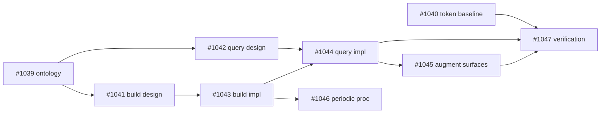

# Refinement drafts: Knowledge Graph Brain (Epic #1010)

**Parent Epic:** #1010 — Knowledge graph brain  
**Binding Q&A:** Question #1011 — `docs/curiosity/refinement-qa-pack-1011-knowledge-graph-brain.md` (Andrew, 2026-10-03; PR #1026)  
**Milestone:** Knowledge graph brain  
**Purpose:** Turn child stubs #1039–#1047 into implementation-ready plans without reopening settled decisions.

Andrew's answers in the Q&A pack are **binding**. This document adds draft scope, non-goals, acceptance criteria anchored in this repository, dependency order, and **only** questions where the recorded answers leave a real gap.

---

## Execution order and dependencies

| Phase | Issues | Rationale |
|-------|--------|-----------|
| **1 — Research (parallel)** | #1039, #1040 | Ontology and measurement protocol unblock design; no code dependency between them. |
| **2 — Design (parallel after #1039)** | #1041, #1042 | Build and query designs both need the node/edge catalog from #1039. |
| **3 — Build** | #1043 | Requires #1041 storage and ingest design. |
| **4 — Query** | #1044 | Requires #1043 artifact on disk and #1042 API contract. |
| **5 — Integration** | #1045, #1046 | #1045 needs query tools; #1046 needs `gh plate kg refresh` from #1043. |
| **6 — Verification** | #1047 | Needs runnable CLI/MCP (#1044) and preferably augmented surfaces (#1045) for the controlled experiment. |

**Cross-Epic dependencies (unchanged):** #1015 (`docs/plate/` namespacing), #660 (PM), #470 (AutonomyEngine / procedures), #218/#224 (Goals/wiki), #1017 (shell scripts for operator scripts).

---

## #1039 — Research: PLATE process ontology for the knowledge graph

**Issue:** https://github.com/akasper/plate/issues/1039

### Proposed scope

- Author the v1 **entity catalog** (coarse node types + deep PLATE properties) and **edge catalog** (including Issue→Issue `depends-on` / `blocks`).
- Map each node type to **concrete ingest sources** in this repo: GitHub Issues/PRs/review threads, Milestones, `.agentic/releases/unreleased/*.json` and versioned fragment dirs, root `AGENTS.md`, `SPEC.md`, `CURRENT.md`, `.plate`, design/research under `docs/plate/` (or legacy `docs/design/` / `docs/research/` when namespacing is absent — see bootstrap resolution in `src/plate_core/bootstrap.py`), and `docs/wiki/Goals.md`.
- Document **excluded** sources (code tree, commits, `.github/workflows`, Actions runs) and **deferred** code-level edges.
- Define minimal **stable IDs** for graph entities (e.g. `issue:akasper/plate#1010`, `fragment:unreleased/kg-build.json`) so CLI/MCP and tests can reference them consistently.

### Non-goals

- Implementing ingest or query code.
- SaaS, embeddings, or natural-language query layers.
- Choosing on-disk JSON schema version (left to #1041).

### Draft acceptance criteria

- [ ] `docs/plate/research/kg-ontology.md` exists (or `docs/research/kg-ontology.md` only if this repo has not yet completed #1015 namespacing — prefer `docs/plate/research/` in `akasper/plate`).
- [ ] Every v1 node type lists ingest source paths and PLATE-specific properties (e.g. Epic success criteria, `risk:*`, release track, fragment `change_type` / `semver` signals).
- [ ] Edge section includes Feature/Task/Question→Epic, PR→Issue, fragment→Feature, Epic→Release, design doc→Epic/Feature, wiki→Feature, and Issue→Issue depends-on/blocks with parsing rules (labels, sub-issues, body keywords).
- [ ] Explicit "not in v1" table for code/commit/CI sources and file/function edges.
- [ ] Cross-links to binding Q&A pack Q1–Q4, Q8.

### Dependencies

- **Blocks:** #1041, #1042, #1043, #1044.
- **Blocked by:** none (start here).

---

## #1040 — Research: Token savings baseline and measurement strategy

**Issue:** https://github.com/akasper/plate/issues/1040

### Proposed scope

- Define the **synthetic benchmark**: fixed query set aligned with the seven v1 process queries, each with a documented "naive baseline" prompt (e.g. full `AGENTS.md` excerpt + `gh issue list` dumps vs narrow KG subgraph).
- Define the **controlled experiment** protocol (same agent task, with/without KG MCP tools; token count source — host usage or estimated prompt size; minimum run count).
- Define **ongoing monitoring** after v1 (what to log, where — e.g. USAGE REPORT blocks, `.agentic/` ledgers — without new product code in this Research issue).
- Set the success bar at **30–50%** on process-heavy queries only.

### Non-goals

- Running benchmarks or publishing final numbers (that's #1047).
- Code/CI/provenance queries in the benchmark suite.

### Draft acceptance criteria

- [ ] `docs/plate/research/kg-token-savings-baseline.md` documents synthetic queries, naive baselines, and expected KG tool invocations (`plate_kg_query` / `gh plate kg query` per binding Q5).
- [ ] Controlled experiment names concrete tasks (e.g. "plan next Feature for Epic #1010", "report epic status for milestone Knowledge graph brain") and references `tests/test_what_next.py` / `tests/test_epics.py` patterns for fixture repos.
- [ ] Measurement order is synthetic → controlled experiment → monitoring (binding Q9).
- [ ] Success bar stated as 30–50% process-heavy only (binding Q10).

### Dependencies

- **Blocks:** #1047.
- **Blocked by:** none (parallel with #1039).

---

## #1041 — Design: Knowledge graph build pipeline and storage model

**Issue:** https://github.com/akasper/plate/issues/1041

### Proposed scope

- Design **full rebuild** pipeline: fetch GitHub (Issues, PRs, review threads, Milestones) + read local artifacts (`AGENTS.md`, `SPEC.md`, `CURRENT.md`, `.plate`, fragments under `.agentic/releases/`, docs paths from #1039, `docs/wiki/Goals.md`).
- Specify on-disk layout under **`.agentic/kg/`** (binding: working file `graph.json` + metadata such as `built_at`, `repo`, `schema_version`, `github_api_snapshot` hints).
- Specify **staleness** fields exposed to query layer (timestamp only in design; threshold policy is an open question below).
- Align with **shell-script** operator conventions (#1017) for any auxiliary fetch scripts.
- Propose implementation home: new package `src/plate_core/kg/` (build, schema, refresh) wired from `src/plate_core/cli.py`.

### Non-goals

- Incremental updates, webhooks, refresh-on-query.
- `.plate` schema changes in the design PR (Feature #1043 owns runtime config if needed).
- Hosted/SaaS storage.

### Draft acceptance criteria

- [ ] `docs/plate/design/kg-build-pipeline.md` describes fetch → normalize → emit graph steps and error handling when GitHub is unavailable.
- [ ] JSON schema documents nodes, edges, properties, and provenance URLs for every entity.
- [ ] Refresh triggers documented: on-demand `gh plate kg refresh` (new subparser alongside `health`, `epic`, `autonomy` in `src/plate_core/cli.py`) and periodic procedure hook (#1046).
- [ ] Explicit exclusion of code/commit/CI inputs in pipeline diagram.
- [ ] Fixture strategy for tests: small committed snapshot under `tests/fixtures/kg/` (referenced by #1043).

### Dependencies

- **Blocks:** #1043, #1046.
- **Blocked by:** #1039.

---

## #1042 — Design: Knowledge graph query API and result format

**Issue:** https://github.com/akasper/plate/issues/1042

### Proposed scope

- Specify **CLI**: `gh plate kg refresh`, `gh plate kg query`, `gh plate kg get` (flags: `--json`, repo default from git remote, query templates for the seven v1 questions).
- Specify **MCP** tools: `plate_kg_query`, `plate_kg_get_entity`, `plate_kg_traverse` registered in `src/plate_core/mcp_server.py` and profiled in `src/plate_core/mcp/tool_profiles.py` (new `kg` or `process` profile — see open questions).
- Specify **narrow cited subgraph** JSON: nodes, edges, `url`, `snippet`, `stale`, `fallback_used` — not full issue bodies (binding Q6).
- For each **seven v1 queries**, document graph traversal (including blocking Features via Issue→Issue depends-on/blocks per binding Q4/Q8).
- **Staleness behavior:** missing or stale graph → GitHub API fallback + log event (binding Q11); integrate with existing GitHub client patterns in `src/plate_core/epics.py`, `src/plate_core/what_next.py`.

### Non-goals

- Natural-language query translation.
- Augmenting `plate_what_next` / `plate_epic_status` (that's #1045).
- Browser UI.

### Draft acceptance criteria

- [ ] `docs/plate/design/kg-query-api.md` includes JSON Schema or exemplar payloads for each v1 query.
- [ ] Release base branch query documents use of `src/plate_core/release.py` (`ReleaseStatus` / track branches `release-minor`, etc.) as fallback when graph edge is insufficient.
- [ ] Refinement Issues query documents label intersection (`need:refinement`, `status:stub`) consistent with label-check workflows under `.github/workflows/`.
- [ ] PRs awaiting human review query ties to merge gate / review state surfaces used in `src/plate_core/pr_babysit.py` and PR gate checks.
- [ ] Fallback path specifies logging destination (stderr, `.agentic/kg/refresh.log`, or autonomy run log).

### Dependencies

- **Blocks:** #1044.
- **Blocked by:** #1039 (traversals need ontology).

---

## #1043 — Feature: Knowledge graph build and refresh

**Issue:** https://github.com/akasper/plate/issues/1043

### Proposed scope

- Implement `gh plate kg refresh` per #1041; write `.agentic/kg/graph.json` + metadata.
- Ingest all binding sources including **PR review threads** (reuse GitHub API patterns from PR babysit / review thread tooling in `src/plate_core/pr_babysit.py` where applicable).
- Emit Issue→Issue depends-on/blocks edges.
- Full rebuild every invocation; update `built_at`.

### Non-goals

- Incremental diff, webhooks, code/CI ingestion.
- Changing `.plate` in the same PR unless a minimal optional `kg` section is required (prefer zero `.plate` change until config need is proven).

### Draft acceptance criteria

- [ ] `src/plate_core/kg/` (or approved module name from #1041) + CLI registration in `src/plate_core/cli.py` for `plate kg refresh`.
- [ ] `tests/test_kg_build.py` (new) uses fixture repo data; asserts graph contains sample Issue, fragment from `.agentic/releases/unreleased/*.json`, and depends-on/blocks edge.
- [ ] Asserts code paths do not read `src/` for symbol indexing.
- [ ] Staleness timestamp written and readable by query layer.
- [ ] Release fragment under `.agentic/releases/unreleased/` per AGENTS.md (Feature artifact).

### Dependencies

- **Blocks:** #1044, #1046.
- **Blocked by:** #1041.

---

## #1044 — Feature: Knowledge graph query CLI and MCP

**Issue:** https://github.com/akasper/plate/issues/1044

### Proposed scope

- Implement query/get CLI and three MCP tools per #1042.
- Return narrow cited JSON; implement all **seven v1 queries** as named operations or documented query parameters.
- On missing/stale graph: **fallback to GitHub API** and set `fallback_used` in output (binding Q11).

### Non-goals

- Replacing GitHub as SOR.
- Dumping full issue bodies.

### Draft acceptance criteria

- [ ] `tests/test_kg_query.py` covers each v1 query with fixture graph + one fallback test when graph absent.
- [ ] `tests/test_mcp.py` registers and calls `plate_kg_query` / `plate_kg_get_entity` / `plate_kg_traverse`.
- [ ] Wiki/Goals query reads `docs/wiki/Goals.md` (or namespaced path via bootstrap helper).
- [ ] Fragments-per-Feature query links `.agentic/releases/unreleased/<slug>.json` entries via `links` / issue numbers in fragment JSON.
- [ ] Release fragment under `.agentic/releases/unreleased/`.

### Dependencies

- **Blocks:** #1045, #1047.
- **Blocked by:** #1042, #1043.

---

## #1045 — Feature: Augment what-next and epic status with the knowledge graph

**Issue:** https://github.com/akasper/plate/issues/1045

### Proposed scope

- When `.agentic/kg/graph.json` is **fresh**, `plate_what_next` and `plate_epic_status` may narrow GitHub fetches using the graph (`src/plate_core/what_next.py`, `src/plate_core/epics.py`, CLI `cmd_what_next` / `cmd_epic_status`, MCP handlers in `src/plate_core/mcp_server.py`).
- On stale/missing graph, behavior matches **today's GitHub-only path** (binding Q7/Q11).
- Optional: log when graph shortcut saved tokens (feeds #1047).

### Non-goals

- Making the graph mandatory for process surfaces.
- Replacing PM orchestrator logic wholesale (`src/plate_core/pm.py`) — see open question on PM scope vs binding Q7.

### Draft acceptance criteria

- [ ] Tests in `tests/test_what_next.py` and `tests/test_epics.py` (or `tests/test_kg_integration.py`) cover fresh-graph and fallback paths.
- [ ] No change to default ranking ladder in `SPEC.md` / `recommend_what_next` ordering unless graph path is strictly optional.
- [ ] Release fragment documents surface touch points.
- [ ] Document in artifact that PM augmentation is in or out of v1 per Andrew's answer to open question #2 below.

### Dependencies

- **Blocks:** #1047 (controlled experiment realism).
- **Blocked by:** #1044.

---

## #1046 — Feature: Periodic knowledge graph refresh procedure

**Issue:** https://github.com/akasper/plate/issues/1046

### Proposed scope

- Add JSON procedure under `.agentic/procedures/` (working name `kg-refresh-nightly.json`) modeled on `nightly-drift-detection.json`: cadence, `risk_level: low`, step invoking `gh plate kg refresh` or MCP equivalent shell step.
- Register with AutonomyEngine loader in `src/plate_core/autonomy.py` (`_load_procedures` reads `.agentic/procedures/*.json`).
- Safe to skip when autonomy `risk_tolerance` is `off` or schedules disabled.

### Non-goals

- Webhook listeners.
- Incremental refresh.

### Draft acceptance criteria

- [ ] Procedure file exists and is valid against existing procedure schema.
- [ ] `tests/test_autonomy.py` or dedicated test loads procedure and dry-run does not require network when skipped.
- [ ] Documented in design doc and release fragment; no `.plate` edit unless autonomy schedules need explicit enablement.
- [ ] Same full rebuild as manual refresh (#1043).

### Dependencies

- **Blocked by:** #1043.
- **Parallel with:** #1045 after #1044.

---

## #1047 — Research: Token savings verification and benchmark report

**Issue:** https://github.com/akasper/plate/issues/1047

### Proposed scope

- Execute synthetic benchmark from #1040 against implemented #1044 (and #1045 if in scope).
- Run controlled experiment; document pass/fail vs **30–50%** bar.
- Publish `docs/plate/research/kg-token-savings-report.md` with per-query tables and monitoring recommendations.

### Non-goals

- Claiming savings on code-navigation or CI queries.
- SaaS or embedding follow-ups.

### Draft acceptance criteria

- [ ] Report separates synthetic, controlled, and monitoring sections (binding Q9 order).
- [ ] Each of the seven v1 queries has a synthetic row with token counts (before/after).
- [ ] States clearly whether the 30–50% bar was met for process-heavy workloads.
- [ ] Links to test/fixture commands reproducible in CI or documented local script under `scripts/` (shell per #1017).

### Dependencies

- **Blocked by:** #1040, #1044; **should follow** #1045 when PM/augment scope is settled.

---

## Open questions for Andrew

Only gaps **not** closed by the Q&A pack or Epic body. Recommended defaults are for agent use if you do not override.

1. **Staleness threshold** — When is the graph "fresh" vs "stale" for fallback (binding Q11 requires fallback but not a TTL)?  
   **Recommended default:** Treat as stale if `built_at` is older than **24 hours** *or* any tracked GitHub Issue/PR `updated_at` in the subgraph is newer than `built_at`; otherwise use the graph and still allow optional force-refresh flag.

2. **PM orchestrator augmentation** — Binding Q7 names PM with what-next and epic status; child #1045 only lists the latter two. Should `src/plate_core/pm.py` (`_collect_work_items` / `get_what_next` paths) use the graph in v1?  
   **Recommended default:** **Defer PM to a follow-up Feature** under #1010 only if #1045 ships first; otherwise extend #1045 acceptance criteria to include PM read-through with the same fallback rules.

3. **`.agentic/kg/` git policy** — Is `graph.json` committed, gitignored like `.agentic/scheduled_ops/`, or commit only a schema/example?  
   **Recommended default:** **Gitignore** `.agentic/kg/*` except `README.md` documenting refresh; committed **fixtures** live under `tests/fixtures/kg/`.

4. **"Features block Epic" semantics** — Besides Issue→Issue depends-on/blocks edges, should open incomplete child Features (milestone/sub-issue) count as "blocking" for query (1)?  
   **Recommended default:** **Yes for v1:** return union of (a) Features linked by `blocks`/`depends-on` edges and (b) open non-Epic children of the Epic without `status:implemented`, with each result citing label/state provenance.

5. **PR review thread node shape** — One node per review thread vs aggregate per PR?  
   **Recommended default:** **One node per thread** with edge PR→thread and thread→suggestion snippets capped (narrow cited subgraph).

6. **`docs/plate/` vs legacy paths** — Epic artifacts target `docs/plate/` (#1015). Should build ingest use `resolve_local_goals_wiki` / import-payload path rules for adopters not yet namespaced?  
   **Recommended default:** **Yes** — same resolution as `src/plate_core/bootstrap.py` and `docs/migration/namespace-docs-migration.md`.

7. **MCP tool profile** — Which `PLATE_MCP_TOOL_PROFILES` bucket should host KG tools?  
   **Recommended default:** Add tools to existing **`process`** profile alongside `plate_what_next` and `plate_feed` in `src/plate_core/mcp/tool_profiles.py`.

8. **Periodic refresh cadence** — Default schedule for `kg-refresh-nightly` when autonomy schedules are enabled?  
   **Recommended default:** **`nightly`** cadence, `risk_level: low`, `enabled: false` in template until user opts in (matches drift-detection pattern).

---

## Recording notes

- Do **not** clear `status:stub` or `need:refinement` on Epic or children until each issue's own refinement ceremony (`mark_ready` / stub process in AGENTS.md).
- Implementation PRs target **`release-minor`** (or track from `gh plate release status`) with `Closes #N` on the **child** issue, not this draft file alone.
- This file is a **Documentation** artifact for planning; it does not satisfy Feature closure for #1039–#1047.

**References**

- Epic #1010, Question #1011, children #1039–#1047  
- `docs/curiosity/refinement-qa-pack-1011-knowledge-graph-brain.md`  
- `SPEC.md` (what_next ladder, autonomy procedures)  
- `docs/design/autonomous-plate-engine.md` (`.agentic/procedures/`)