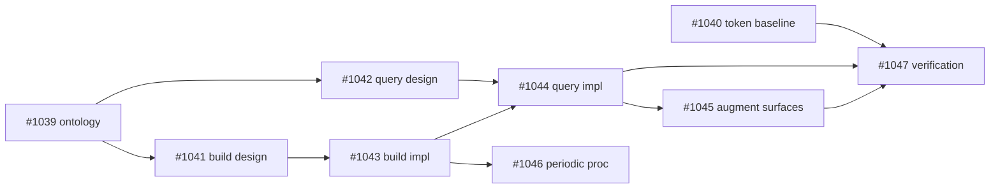

# Refinement drafts: Knowledge Graph Brain (Epic #1010)

**Parent Epic:** #1010 — Knowledge graph brain  
**Binding Q&A:** Question #1011 — `docs/curiosity/refinement-qa-pack-1011-knowledge-graph-brain.md` (Andrew, 2026-10-03; PR #1026)  
**Milestone:** Knowledge graph brain  
**Purpose:** Turn child stubs #1039–#1047 into implementation-ready plans without reopening settled decisions.

Andrew's answers in the Q&A pack are **binding**. This document adds dependency order, implementation constraints, **gaps only** (not a second copy of stub acceptance criteria), and open questions where answers still leave a real gap.

---

## In-flight audit (2026-11-28)

For each child stub, `gh pr list --state open --search "<n> in:body"` and issue comments were checked before extending this draft.

| Stub | Open PRs (body refs) | Issue comments with refinement |
|------|---------------------|--------------------------------|
| #1039–#1047 | None besides [PR #1557](https://github.com/akasper/plate/pull/1557) | **None** (0 comments each) |
| Epic #1010 | — | [Comment (2026-10-23)](https://github.com/akasper/plate/issues/1010#issuecomment-6378007314): **code-level graph via optional external adapter** (#1198 admission), not in-process PLATE indexing — aligns with Q&A non-goals |

**Source-of-truth order for each stub:** (1) child issue body **Known scope** + **Acceptance criteria**, (2) Q&A pack #1011, (3) Epic #1010 body, (4) this file (**gaps and cross-links only**).

**Related open work (do not contradict):**

| PR | Track | Implication for #1010 implementation |
|----|-------|--------------------------------------|
| [#1544](https://github.com/akasper/plate/pull/1544) | MCP `MCP_TOOL_HANDLERS` map (#1543) | New MCP tools: handler in `MCP_TOOL_HANDLERS`, schema in `src/plate_core/mcp/tool_definitions.py` (`MCP_TOOL_DEFINITIONS`), profile in `src/plate_core/mcp/tool_profiles.py`; registry tests in `tests/test_mcp_registry.py` |
| [#1536](https://github.com/akasper/plate/pull/1536) | `docs/plate/research/public-surface-inventory.md` (#1056) | Any new **public** CLI `kg` family or MCP tools must be classified and listed in the inventory |
| [#1538](https://github.com/akasper/plate/pull/1538) | `docs/cli-mcp-reference.md` + `scripts/generate-cli-mcp-reference.py` (#1068) | After inventory update: regenerate reference; `tests/test_cli_mcp_reference.py` / `--check` must pass |

Binding **command and tool names** remain as in the Q&A pack and stub bodies: `gh plate kg refresh|query|get`, `plate_kg_query`, `plate_kg_get_entity`, `plate_kg_traverse`.

---

## Shared implementation constraints (Features #1043–#1046)

These apply to every implementation PR; they are not repeated per stub.

- **CLI:** Register under `build_parser()` in `src/plate_core/cli.py` (same pattern as `epic`, `autonomy`, `qanda`).
- **MCP:** After [#1544](https://github.com/akasper/plate/pull/1544) lands, wire tools through **`MCP_TOOL_HANDLERS`** in `src/plate_core/mcp_server.py`, definitions in **`MCP_TOOL_DEFINITIONS`** (`src/plate_core/mcp/tool_definitions.py`), and **`profiles_for_tool()`** in `src/plate_core/mcp/tool_profiles.py`. Do not add a parallel dispatch path.
- **Public surface:** Update `docs/plate/research/public-surface-inventory.md` ([#1536](https://github.com/akasper/plate/pull/1536)) and regenerate `docs/cli-mcp-reference.md` via `scripts/generate-cli-mcp-reference.py` ([#1538](https://github.com/akasper/plate/pull/1538)).
- **Storage:** Binding path `.agentic/kg/` with `graph.json` and `built_at` (Q&A pack); git policy is open question #3 below.
- **Procedures:** `.agentic/procedures/*.json` loaded by `src/plate_core/autonomy.py` (see `nightly-drift-detection.json`).
- **No `.plate` edits** in refinement/early Features unless a child issue explicitly requires runtime config (per stub #1043).

---

## Execution order and dependencies

| Phase | Issues | Rationale |
|-------|--------|-----------|
| **1 — Research (parallel)** | #1039, #1040 | Ontology and measurement protocol unblock design; no code dependency between them. |
| **2 — Design (parallel after #1039)** | #1041, #1042 | Build and query designs both need the node/edge catalog from #1039. |
| **3 — Build** | #1043 | Requires #1041 storage and ingest design. |
| **4 — Query** | #1044 | Requires #1043 artifact on disk and #1042 API contract. |
| **5 — Integration** | #1045, #1046 | #1045 needs query tools; #1046 needs `gh plate kg refresh` from #1043. |
| **6 — Verification** | #1047 | Needs runnable CLI/MCP (#1044) and preferably augmented surfaces (#1045) for the controlled experiment. |

**Cross-Epic dependencies (unchanged):** #1015 (`docs/plate/` namespacing), #660 (PM), #470 (AutonomyEngine / procedures), #218/#224 (Goals/wiki), #1017 (shell scripts for operator scripts).

---

## #1039 — Research: PLATE process ontology for the knowledge graph

**Issue:** https://github.com/akasper/plate/issues/1039 — ACs and scope are on the issue; artifact `docs/plate/research/kg-ontology.md`.

### Gaps this draft adds

- **Stable entity IDs** for tests/MCP (e.g. `issue:owner/repo#N`, `fragment:unreleased/<slug>.json`) — not specified on the stub.
- **Ingest path resolution:** use the same namespaced vs legacy doc roots as `src/plate_core/bootstrap.py` / #1015 migration doc (open question #6).
- **Epic #1010 (2026-10-23):** document that future **code** graph is an **optional external adapter** (#1198), not v1 PLATE nodes — extends stub “no code edges” without reopening Q&A.

### Dependencies

**Blocks:** #1041, #1042. **Blocked by:** none.

---

## #1040 — Research: Token savings baseline and measurement strategy

**Issue:** https://github.com/akasper/plate/issues/1040 — ACs on the issue; artifact `docs/plate/research/kg-token-savings-baseline.md`.

### Gaps this draft adds

- Name **fixture harnesses** already in repo for controlled tasks: `tests/test_what_next.py`, `tests/test_epics.py`, USAGE REPORT harvesting in `src/plate_core/costs.py` (monitoring signal).
- Synthetic runs should invoke the **same tool names** as #1044 (`plate_kg_*` / `gh plate kg *`) once implemented — no alternate naming.

### Dependencies

**Blocks:** #1047. **Parallel with:** #1039.

---

## #1041 — Design: Knowledge graph build pipeline and storage model

**Issue:** https://github.com/akasper/plate/issues/1041 — ACs on the issue; artifact `docs/plate/design/kg-build-pipeline.md`.

### Gaps this draft adds

- Recommend implementation package `src/plate_core/kg/` (final name on issue if Andrew prefers otherwise).
- **Staleness metadata** field design only — threshold behavior deferred to open question #1 (#1042/query layer).
- **Test fixtures:** committed snapshots under `tests/fixtures/kg/` (stub #1043 requires fixture coverage but not path).
- Reuse GitHub fetch patterns from `src/plate_core/pr_babysit.py` for review threads where applicable.

### Dependencies

**Blocks:** #1043, #1046. **Blocked by:** #1039.

---

## #1042 — Design: Knowledge graph query API and result format

**Issue:** https://github.com/akasper/plate/issues/1042 — ACs on the issue; artifact `docs/plate/design/kg-query-api.md`.

### Gaps this draft adds

- **MCP wire-up:** document handler + schema + profile locations per **Shared implementation constraints** (post-#1544); classify stable vs experimental in public-surface inventory ([#1536](https://github.com/akasper/plate/pull/1536)) — open question #7.
- **Fallback helpers:** cite `src/plate_core/release.py` (release base branch), `src/plate_core/epics.py` / `src/plate_core/what_next.py` (GitHub live paths), `.github/workflows/labels.yml` + `label-check` (refinement label query).
- Response envelope may include `stale` / `fallback_used` flags (binding Q11); exact JSON shape in design doc, not here.

### Dependencies

**Blocks:** #1044. **Blocked by:** #1039.

---

## #1043 — Feature: Knowledge graph build and refresh

**Issue:** https://github.com/akasper/plate/issues/1043 — follow issue ACs verbatim.

### Gaps this draft adds

- Plus **shared constraints:** CLI `kg` subcommand in `src/plate_core/cli.py`; public-surface inventory + cli-mcp-reference update when `kg` is adopter-visible (likely **experimental** until 1.0 freeze).
- Plus release fragment under `.agentic/releases/unreleased/` per AGENTS.md.

### Dependencies

**Blocks:** #1044, #1046. **Blocked by:** #1041.

---

## #1044 — Feature: Knowledge graph query CLI and MCP

**Issue:** https://github.com/akasper/plate/issues/1044 — follow issue ACs (seven queries, narrow JSON, fallback).

### Gaps this draft adds

- MCP: register `plate_kg_query`, `plate_kg_get_entity`, `plate_kg_traverse` via **`MCP_TOOL_HANDLERS`** + **`MCP_TOOL_DEFINITIONS`** + **`profiles_for_tool()`** ([#1544](https://github.com/akasper/plate/pull/1544)); extend `tests/test_mcp_registry.py` dispatch/key parity.
- Tests: stub requires coverage per query — use fixtures from #1041; may extend `tests/test_mcp.py` rather than inventing parallel harness if equivalent.
- **Public surface:** inventory ([#1536](https://github.com/akasper/plate/pull/1536)) + regenerated `docs/cli-mcp-reference.md` ([#1538](https://github.com/akasper/plate/pull/1538)).

### Dependencies

**Blocks:** #1045, #1047. **Blocked by:** #1042, #1043.

---

## #1045 — Feature: Augment what-next and epic status with the knowledge graph

**Issue:** https://github.com/akasper/plate/issues/1045 — ACs on the issue (what-next + epic status, fallback).

### Gaps this draft adds

- Touch points: `src/plate_core/what_next.py`, `src/plate_core/epics.py`, existing MCP/CLI paths (handlers remain in `MCP_TOOL_HANDLERS` — no new tool names required unless design adds read helpers).
- **PM orchestrator:** binding Q7 mentions PM; stub #1045 does not — see open question #2 (do not implement PM graph reads until decided).
- Optional token logging for #1047; do not alter `SPEC.md` what_next ladder ordering.

### Dependencies

**Blocks:** #1047 (realism). **Blocked by:** #1044.

---

## #1046 — Feature: Periodic knowledge graph refresh procedure

**Issue:** https://github.com/akasper/plate/issues/1046 — ACs on the issue; working name `kg-refresh-nightly` in stub.

### Gaps this draft adds

- Model procedure JSON on `.agentic/procedures/nightly-drift-detection.json`; loader in `src/plate_core/autonomy.py`.
- Cadence default: open question #8 (`enabled: false` until opt-in).
- If procedure invokes MCP, use existing autonomy step patterns — no new autonomy MCP tools required.

### Dependencies

**Blocked by:** #1043. **Parallel with:** #1045 after #1044.

---

## #1047 — Research: Token savings verification and benchmark report

**Issue:** https://github.com/akasper/plate/issues/1047 — ACs on the issue; artifact `docs/plate/research/kg-token-savings-report.md`.

### Gaps this draft adds

- Runbook should reference #1040 methodology and **production surfaces** from #1044/#1045 only (no duplicate benchmark tooling in `scripts/` unless #1040 specifies).
- Shell scripts for one-off runs stay **#1017**-style if added.

### Dependencies

**Blocked by:** #1040, #1044; prefer **after** #1045 when open question #2 is settled.

---

## Open questions for Andrew

Only gaps **not** closed by the Q&A pack or Epic body. Recommended defaults are for agent use if you do not override.

1. **Staleness threshold** — When is the graph "fresh" vs "stale" for fallback (binding Q11 requires fallback but not a TTL)?  
   **Recommended default:** Treat as stale if `built_at` is older than **24 hours** *or* any tracked GitHub Issue/PR `updated_at` in the subgraph is newer than `built_at`; otherwise use the graph and still allow optional force-refresh flag.

2. **PM orchestrator augmentation** — Binding Q7 names PM with what-next and epic status; child #1045 only lists the latter two. Should `src/plate_core/pm.py` (`_collect_work_items` / `get_what_next` paths) use the graph in v1?  
   **Recommended default:** **Defer PM to a follow-up Feature** under #1010 only if #1045 ships first; otherwise extend #1045 acceptance criteria to include PM read-through with the same fallback rules.

3. **`.agentic/kg/` git policy** — Is `graph.json` committed, gitignored like `.agentic/scheduled_ops/`, or commit only a schema/example?  
   **Recommended default:** **Gitignore** `.agentic/kg/*` except `README.md` documenting refresh; committed **fixtures** live under `tests/fixtures/kg/`.

4. **"Features block Epic" semantics** — Besides Issue→Issue depends-on/blocks edges, should open incomplete child Features (milestone/sub-issue) count as "blocking" for query (1)?  
   **Recommended default:** **Yes for v1:** return union of (a) Features linked by `blocks`/`depends-on` edges and (b) open non-Epic children of the Epic without `status:implemented`, with each result citing label/state provenance.

5. **PR review thread node shape** — One node per review thread vs aggregate per PR?  
   **Recommended default:** **One node per thread** with edge PR→thread and thread→suggestion snippets capped (narrow cited subgraph).

6. **`docs/plate/` vs legacy paths** — Epic artifacts target `docs/plate/` (#1015). Should build ingest use `resolve_local_goals_wiki` / import-payload path rules for adopters not yet namespaced?  
   **Recommended default:** **Yes** — same resolution as `src/plate_core/bootstrap.py` and `docs/migration/namespace-docs-migration.md`.

7. **MCP stable vs experimental** — How should `plate_kg_*` tools be classified in `docs/plate/research/public-surface-inventory.md` ([#1536](https://github.com/akasper/plate/pull/1536))?  
   **Recommended default:** **experimental** for v1 (opt-in profile bucket TBD in #1042 design; default expansion likely `process` alongside `plate_what_next`).

8. **Periodic refresh cadence** — Default schedule for `kg-refresh-nightly` when autonomy schedules are enabled?  
   **Recommended default:** **`nightly`** cadence, `risk_level: low`, `enabled: false` in template until user opts in (matches drift-detection pattern).

---

## Recording notes

- Do **not** clear `status:stub` or `need:refinement` on Epic or children until each issue's own refinement ceremony (`mark_ready` / stub process in AGENTS.md).
- Implementation PRs target **`release-minor`** (or track from `gh plate release status`) with `Closes #N` on the **child** issue, not this draft file alone.
- This file is a **Documentation** artifact for planning; it does not satisfy Feature closure for #1039–#1047.

**References**

- Epic #1010, Question #1011, children #1039–#1047  
- `docs/curiosity/refinement-qa-pack-1011-knowledge-graph-brain.md`  
- `SPEC.md` (what_next ladder, autonomy procedures)  
- `docs/design/autonomous-plate-engine.md` (`.agentic/procedures/`)