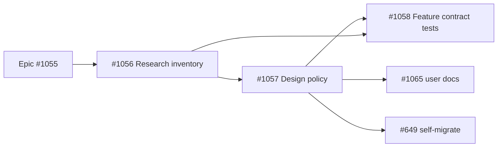

# Refinement drafts: 1.0 public-surface promise (Epic #1055)

**Parent Epic:** #1055 — 1.0 compatibility: public-surface promise (full semver)  
**Milestone:** 1.0  
**Parent roadmap:** #654 (PLATE v1.0.0 far-future target)  
**Prepared for:** Andrew (stub refinement pass; issues stay `status:stub` until `mark_ready`)  
**Status:** Draft refinement only — does not clear stub labels or edit issues

---

## Overview

Epic #1055 turns Andrew's 1.0 decisions (2026-10-04, recorded under #654) into three ordered child stubs. Today the repo has strong **release-ceremony semver** (`gh plate release status|cut|finalize`, fragments under `.agentic/releases/unreleased/`, `Major` / `Minor` / `Patch` labels in `.github/labels.yml`, multi-track branches per `docs/design/release-ceremony-refinement.md`) but no single **inventory of what adopters may rely on** across CLI, MCP, `.plate`, fragments, `.agentic/` layouts, and labels.

**Child order (dependency chain):**

1. **#1056** Research — inventory (source of truth for stable / experimental / internal).
2. **#1057** Design — deprecation + compatibility policy mapped to that inventory.
3. **#1058** Feature — CI contract tests that fail when stable surface drifts without an explicit version decision.

Epic non-goals (unchanged): no `.plate` schema edits in this Epic; no freezing surface before 1.0; LTS branches only if policy child chooses.

Related: #1015 (`docs/plate/` namespacing for adopter-oriented docs — inventory likely lives there, not only under `docs/curiosity/`), #649 (self-migration path must appear in policy), #1065 (1.0 user docs / upgrade guide must cite policy).

---

## Stub #1056 — Research: public-surface inventory for 1.0

**Issue:** [#1056](https://github.com/akasper/plate/issues/1056)  
**Type:** Research · **Labels today:** `Research`, `area:product`, `area:cli`, `risk:low`, `status:stub`, `need:refinement`

### Proposed scope

Produce a **versioned, machine-readable inventory** plus a human-readable research note that enumerates everything 1.0 is allowed to promise. Each entry gets exactly one **stability class**: `stable`, `experimental`, or `internal`.

Surface classes (from stub + Epic #1055), grounded in this repository:

| Class | Where truth lives today | Inventory should capture |
|---|---|---|
| **CLI** | `src/plate_core/cli.py` (`prog="gh plate"`); entry `python -m plate_core.cli` / gh extension wiring | Top-level commands and subcommands (e.g. `health`, `bootstrap`, `config`, `release`, `pr`, `autonomy`, `import-payload`, `self-migrate`, `what-next`, `pm`, `stub`, …) and **stable flags** on adoption/release/review paths (`gh plate config validate`, `gh plate pr verify`, `gh plate release status`) |
| **MCP** | `src/plate_core/mcp_server.py`, profiles in `src/plate_core/mcp/tool_profiles.py`, `docs/mcp.md` | Tool names matching `plate_*` (209 tools via `list_mcp_tool_names()`); profile names (`default`, `release`, `qanda`, `all`, …) as **experimental** unless promoted; JSON schema fields per tool where feasible |
| **`.plate` config** | `src/plate_core/plate_config.py` (`CURRENT_CONFIG_VERSION` **1.4**, `ALLOWED_CONFIG_TOP_LEVEL_KEYS`, `DEFAULT_CONFIG`) | Top-level keys, nested keys under `methodology`, `extensions`, `release`, `autonomy`, `hooks`, `process_docs`; distinguish **documented adopter keys** vs parser internals |
| **Release fragments** | `.agentic/releases/unreleased/README.md`, `validate_fragment()` in `src/plate_core/release.py` | Required fields: `slug`, `change_type`, `surface`, `summary`, `migration_impact`, `agent_notes`; allowed `change_type` values; optional `breaking`, `links`, `requires`, `media` |
| **`.agentic/` layouts** | `.agentic/process.yml` `artifacts:` map; template payload `src/plate_core/template_payload/.agentic/` | Expected files: `process.yml`, `skills.yml`, `extensions.yml`, `audit.yml`, `traceability.yml`, `marketing.yml`, `migration.yml`, `ui-paths.yml`, `COSTS.md`, `releases/unreleased/` + `epic-<NNN>-<slug>/` convention |
| **Labels** | `.github/labels.yml`, enforced by `.github/workflows/label-check` / `plate-pr-gates` | Issue type labels (`Feature`, `Bug`, …), PR type labels, `area:*`, `risk:*`, `need:*`, `status:*` (at most one), semver track `Major`/`Minor`/`Patch`, process labels (`no-issue`, `auto-merge`, release-window labels) |

The research note should list **gaps and inconsistencies** (e.g. repo `.plate` `version` **1.3** while code default is **1.4**; MCP tools hidden behind profiles; CLI commands with no MCP parity).

### Non-goals

- Defining deprecation windows or semver impact rules (stub #1057).
- Implementing CI guards (stub #1058).
- Changing runtime code, `.plate` on disk, workflows, or label enforcement.
- Promising every CLI subcommand — inventory may mark loop/autonomy/pm surfaces as `experimental` until 1.0 sign-off.

### Draft acceptance criteria

- [ ] Research artifact committed under `docs/plate/research/public-surface-inventory-1056.md` (or `docs/research/` if #1015 is not ready — **path is an open question below**).
- [ ] Machine-readable inventory committed (proposed: `docs/plate/compat/public-surface-inventory.json` with a `schema_version` field).
- [ ] All six surface classes above populated; each entry has `id`, `kind`, `stability`, `semver_promise` (boolean for `stable` only), and `source_pointer` (repo path or command string).
- [ ] Gap section cites at least: MCP profile vs `all` parity (`docs/mcp.md`), fragment vs `validate_fragment` required fields, `.agentic/process.yml` artifact map vs template payload drift.
- [ ] Research PR labeled `Documentation`, body `Closes #1056` (when implemented — not this draft PR).

### Dependencies

- **Blocks:** #1057, #1058 (both need inventory IDs and stability classes).
- **Soft inputs:** #654 roadmap text, #649 self-migrate surfaces, existing audit patterns (`docs/research/test-classification-inventory.md`, `validate_closing_keyword_parsing_contract` style in `src/plate_core/pr_gates_contract.py`).

### Open questions for Andrew (#1056)

1. **Canonical inventory path:** adopt `docs/plate/compat/public-surface-inventory.json` per #1015, or ship v0 under `docs/research/` and migrate later?  
   **Recommended default:** `docs/plate/compat/` for JSON + `docs/plate/research/public-surface-inventory-1056.md` for narrative (matches Epic #1008 pack convention).

2. **CLI stability grain:** promise entire commands, or only documented “adopter” commands from bootstrap/adoption/release/review (`health`, `bootstrap`, `import-payload`, `self-migrate`, `config`, `release status`, `pr verify|babysit`)?  
   **Recommended default:** stable = adoption + release + review + config subset; mark `pm`, `fleet`, `autonomy --loop`, loops, and planning commands `experimental` until 1.0 doc pass (#1065).

3. **MCP stability:** promise tool **names** only, or also input JSON shapes?  
   **Recommended default:** 1.0 promises **tool names + required argument keys** for `default` profile tools; full schemas for `all` profile remain `experimental`.

4. **`.plate` version field:** is bumping `version` in the file always **major** for adopters?  
   **Recommended default:** yes for stable top-level key additions/removals; minor for new optional nested keys documented in inventory.

5. **Labels:** are new `need:*` / `area:*` labels **minor** additions, while renaming a type label is **major**?  
   **Recommended default:** yes — align with `.github/labels.yml` as stable registry; Projects fields stay out of promise.

---

## Stub #1057 — Design: deprecation and compatibility policy with versioning rules

**Issue:** [#1057](https://github.com/akasper/plate/issues/1057)  
**Type:** Design · **Labels today:** `Design`, `area:product`, `area:docs`, `risk:medium`, `status:stub`, `need:refinement`

### Proposed scope

Design document that maps **inventory stability classes** to **semver semantics** for PLATE 1.0+, including:

- Breaking vs non-breaking rules per surface class (CLI flag removal, MCP rename, `.plate` key removal, new required fragment field, `.agentic/` file renames, label renames).
- **Deprecation window** (time + release count) and **notice mechanisms** (release notes via fragments, `migration_impact`, optional `gh plate health` warning hooks — design only unless a child Feature says otherwise).
- How **self-migration** (#649: `gh plate self-migrate plan|apply`, MCP `plate_self_migrate_*`, offline verify) applies inventory breaking changes to adopters.
- Relationship to **release ceremony**: `breaking: true` on fragments, `Major` label on issues, cut/finalize on `release-major` (per `AGENTS.md` + `docs/agents/branch-model-and-ceremonies.md`).

### Non-goals

- Authoring the inventory (stub #1056).
- Writing contract tests (stub #1058).
- Implementing new deprecation warnings in CLI/MCP in this Design issue (can spawn Features).
- Committing to LTS branches unless Andrew explicitly opts in.

### Draft acceptance criteria

- [ ] Design artifact: `docs/plate/design/deprecation-and-compat-policy-1057.md` (diagram: inventory entry → semver bump type → adopter action).
- [ ] Table: for each surface class, examples of **major / minor / patch** drawn from real repo paths (e.g. removing an MCP tool = major if `stable`; adding optional `.plate` `hooks` key = minor).
- [ ] Deprecation policy specifies minimum **one minor release** with documented warning before removing a `stable` item (exact N open question below).
- [ ] Cross-links: #654, #1056 inventory path, #649 migration flows, placeholder link for #1065 upgrade guide section.
- [ ] README / `docs/plate/README.md` (when present) lists policy; until then, `AGENTS.md` pointer only in design doc (no `AGENTS.md` edit in Design PR unless Andrew wants同步).

### Dependencies

- **Blocked by:** #1056 (inventory IDs and stability classes).
- **Blocks:** #1058 (tests encode policy exceptions), #1065 (upgrade guide cites policy).

### Open questions for Andrew (#1057)

1. **Deprecation duration:** minimum **one** or **two** minor releases with warnings before stable removal?  
   **Recommended default:** two minors OR 90 days, whichever is longer (documented in release notes).

2. **Experimental graduation:** can `experimental` → `stable` happen in a **minor** PLATE release?  
   **Recommended default:** yes, with inventory + release-note callout (no breaking change to adopters who ignored experimental).

3. **Internal surfaces:** confirm `internal` means “may change in patch without semver” and is **excluded from adopter migration guides**.  
   **Recommended default:** yes.

4. **Downstream template repos:** does policy apply to `plate_core/template_payload/` exports only, or also optional extension payloads?  
   **Recommended default:** anything `gh plate import-payload` can write is in scope; extension-only hooks stay `experimental` until documented.

5. **Policy enforcement before 1.0:** advisory-only until tag `v1.0.0`, or enforce stable breaks immediately once inventory merges?  
   **Recommended default:** advisory until `v1.0.0`; contract test ( #1058) runs in **warn** mode until 1.0 cut, then **fail** mode.

---

## Stub #1058 — Feature: compat/contract tests guarding the public-surface inventory

**Issue:** [#1058](https://github.com/akasper/plate/issues/1058)  
**Type:** Feature · **Labels today:** `Feature`, `area:cli`, `area:tests`, `risk:medium`, `status:stub`, `need:refinement`

### Proposed scope

Add automated checks (unit tests + optional lightweight CI job) that compare **live repository facts** to the **inventory artifact** from #1056, applying rules from #1057:

- Fail (or warn pre-1.0) when a **`stable`** entry disappears or changes identity without a paired **version decision** recorded in-repo.
- Ignore `experimental` and `internal` entries for breaking-detection (but may still report drift in advisory mode).
- Document contributor workflow: update inventory + fragment with correct `breaking` / track label when intentionally changing stable surface.

### Non-goals

- Generating inventory from code automatically on every commit (optional later; first slice is test-backed diff).
- Replacing existing gates (`plate-pr-gates`, fragment gate, label-check).
- Blocking changes to `internal` MCP tools or undocumented CLI.

### Draft acceptance criteria

- [ ] New module (proposed): `src/plate_core/compat_inventory.py` + tests `tests/test_compat_public_surface.py` (names TBD in implementation PR).
- [ ] CI runs tests on PRs (likely via existing `tests` job; no new workflow required unless slow).
- [ ] `stable` drift without inventory update fails test; intentional change requires inventory diff **and** either `breaking: true` fragment in PR or inventory `change_log` entry with `semver: major|minor|patch`.
- [ ] Contributor doc section in `docs/plate/compat/README.md` or extension of `docs/mcp.md` / adoption guide.
- [ ] Feature PR includes release fragment under `.agentic/releases/unreleased/<slug>.json` per Feature loop.

### Dependencies

- **Blocked by:** #1056 (inventory file), #1057 (rules for fail vs warn and semver pairing).
- **Informed by:** `tests/test_pr_gates_closing.py` + `validate_*_contract` patterns in `src/plate_core/pr_gates_contract.py`; `list_mcp_tool_names()` in `tool_profiles.py`; `validate_fragment()` field list in `release.py`.

### Contract test sketch (design only — not implemented here)

**Inventory file (read):** `docs/plate/compat/public-surface-inventory.json` (from #1056), shape:

```json
{
  "schema_version": 1,
  "plate_version_promise": "1.0.0",
  "entries": [
    {
      "id": "cli.release.status",
      "kind": "cli_subcommand",
      "stability": "stable",
      "identity": "release status",
      "source_pointer": "src/plate_core/cli.py"
    },
    {
      "id": "mcp.plate_health",
      "kind": "mcp_tool",
      "stability": "stable",
      "identity": "plate_health"
    }
  ],
  "change_log": []
}
```

**Observed surface (derived at test time):**

| Kind | Discovery mechanism | Notes |
|---|---|---|
| `mcp_tool` | `plate_core.mcp.tool_profiles.list_mcp_tool_names()` | Same set as `tools/list` when profiles=`all` |
| `cli_subcommand` | Parse `argparse` tree from `build_parser()` in `cli.py` or golden list generated in research | Avoid shelling out to `gh` in CI |
| `plate_config_key` | `ALLOWED_CONFIG_TOP_LEVEL_KEYS` + documented nested keys from `DEFAULT_CONFIG` | Match `gh plate config validate` |
| `fragment_field` | `REQUIRED_FRAGMENT_FIELDS` + `ALLOWED_CHANGE_TYPES` in `release.py` | Align with `.agentic/releases/unreleased/README.md` |
| `agentic_artifact` | Keys under `.agentic/process.yml` → `artifacts:` | Compare to template payload mirror |
| `label` | Parse `name:` entries from `.github/labels.yml` | Stable label **names** only |

**Assertion logic (per stable entry):**

1. Resolve `identity` in the observed set (e.g. MCP tool name present).
2. If missing or renamed → check PR / repo for **explicit allow**:
   - Inventory `change_log` item with `semver` bump and `rationale`, **or**
   - Unreleased fragment with `"breaking": true` and `surface` referencing inventory id (for Feature PRs).
3. If no allow record → **fail** (post-1.0) or **warn** (pre-1.0 per policy).

**Experimental / internal exclusion:**

- Filter: `if entry["stability"] != "stable": continue` before fail/warn logic.
- Optional informational test: `test_experimental_tools_documented` ensures every `experimental` MCP tool still appears in inventory (no silent orphan), severity `warning` only.

**Example failure messages:**

- `Stable MCP tool 'plate_pr_verify' listed in inventory but not in list_mcp_tool_names() — update inventory or add change_log + breaking fragment.`
- `New label 'area:compat' in .github/labels.yml not in inventory — add as experimental or stable per #1057.`

**CI placement:** extend `tests/test_compat_public_surface.py`; reuse `PYTHONPATH=src python3 -m unittest` per `docs/mcp.md` (`gh plate pr verify --run-tests` pattern).

### Open questions for Andrew (#1058)

1. **Fail mode toggle:** env `PLATE_COMPAT_INVENTORY_MODE=warn|fail` vs hard cutover at `v1.0.0` tag only?  
   **Recommended default:** `warn` on `release-minor` until first `release-v1.0.0` branch exists, then `fail`.

2. **Inventory change_log in-repo vs only release fragments:** require both or fragments-only?  
   **Recommended default:** inventory `change_log` for machine tests; fragments remain human/agent release truth.

3. **Scope of CLI golden checks:** full argparse tree vs curated stable subset file maintained in #1056?  
   **Recommended default:** curated subset in JSON (research enumerates); full tree advisory report only.

4. **MCP JSON Schema depth:** contract test names only at first slice?  
   **Recommended default:** yes for #1058 MVP; schema-hash tests become a follow-up Feature.

5. **Third-party adopters:** run compat tests only in `akasper/plate` or also via `gh plate health` eventually?  
   **Recommended default:** plate repo CI only for #1058; health hook deferred to post-1.0 Feature.

---

## Cross-stub dependency summary



---

## Epic-level open questions (Andrew)

1. **1.0 freeze moment:** is public surface frozen at Git tag `v1.0.0` only, or when `release-v1.0.0` branch is cut?  
   **Recommended default:** frozen at tag; RC branch may still adjust `experimental` classifications.

2. **Semver for `plate-core` PyPI vs PLATE methodology version:** single version line or dual?  
   **Recommended default:** Git tag / GitHub Release is canonical; document PyPI alignment in inventory metadata field.

3. **Extension MCP tools** from third-party `.plate` extensions in inventory?  
   **Recommended default:** out of 1.0 core inventory; document as `experimental` add-on class in research annex.

4. **Who approves stable promotions:** Andrew-only Task, or Documentation PR + human review?  
   **Recommended default:** human-reviewed Documentation or Design PR touching inventory + policy.

---

## Recording status

- This file is a **refinement draft** only. Issues #1056–#1058 retain `status:stub` and `need:refinement` until separate implementation/refinement PRs land.
- Epic #1055 success criterion “child stubs refined” is satisfied when Andrew accepts these drafts (or edits) and child issues follow `agents/stub-issues.md` `mark_ready` flow — **not** by this document alone.

**References**

- Epic #1055: https://github.com/akasper/plate/issues/1055  
- Children: #1056, #1057, #1058  
- Roadmap #654 · Self-migrate #649 · Docs Epic #1065 · Namespacing #1015  
- `AGENTS.md` (Release loop, stub rules) · `docs/design/release-ceremony-refinement.md`  
- Runtime: `src/plate_core/cli.py`, `src/plate_core/mcp_server.py`, `src/plate_core/plate_config.py`, `src/plate_core/release.py`  
- Process memory: `.agentic/process.yml`, `.github/labels.yml`, `.agentic/releases/unreleased/README.md`, `docs/mcp.md`