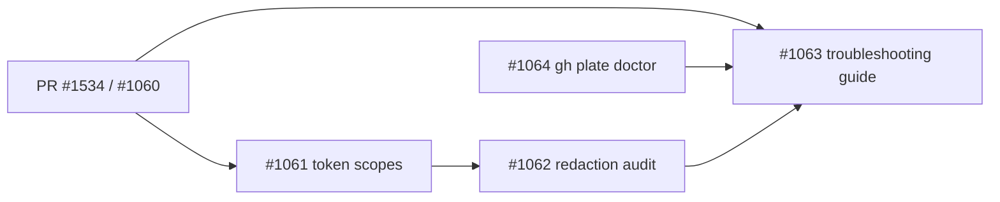

# Refinement drafts: 1.0 security and supportability (Epic #1059)

**Parent Epic:** [#1059](https://github.com/akasper/plate/issues/1059) — 1.0 security and supportability  
**Roadmap anchor:** [#654](https://github.com/akasper/plate/issues/654) — 1.0 definition (decided 2026-10-04)  
**Milestone:** 1.0  
**Prepared for:** Andrew (refinement pass before clearing `status:stub` / `need:refinement` on children)  
**Status:** Draft refinement text only — **does not** edit issues, labels, or stub bodies.

---

## Overview

Epic #1059 closes four gaps called out in #654’s 1.0 bar: a published security policy, token-scope documentation, a secret-redaction audit, and a troubleshooting/doctor story adopters can follow. Five child stubs (#1060–#1064) carry the work; user-docs Epic #1065 links to troubleshooting content owned by #1063 rather than duplicating it.

This document proposes scope, non-goals, acceptance criteria, dependencies, and open questions for each stub. It is written in the same spirit as the `docs/curiosity/refinement-qa-pack-*.md` artifacts: durable repo memory for a refinement session, not implementation.

**Hard constraints for implementers (from Epic #1059 and AGENTS.md):**

- Do not weaken autonomy merge gates, branch protection, or redaction tests to “pass” the audit.
- Describe security gaps at a high level only; audit findings belong in `docs/audits/` without exploit reproduction detail.
- Do not edit `LICENSE`, `.plate/`, workflow files, or `SECURITY.md` in follow-on PRs without their own issues (see in-flight work below).

---

## In-flight work (do not duplicate)

Open PR [#1534](https://github.com/akasper/plate/pull/1534) (`docs: add SECURITY.md with vulnerability disclosure path`) adds repository-root `SECURITY.md` and a README link. It targets **#1060** with `Closes #1060` (Andrew’s 2026-11-27 choice).

| Artifact | State | Implication for refinement |
|---|---|---|
| `SECURITY.md` | Added in PR #1534 | #1060 refinement should treat disclosure policy as **in flight**; remaining #1060 work is follow-ups (template payload copy, #1057 supported-versions wording), not a second root policy. |
| README security line | Same PR | README link AC largely satisfied on merge. |
| `src/plate_core/template_payload/SECURITY.md` | Not in #1534 | Open product question whether adopters get a payload copy via `import-payload` (see #1060 questions). |

Refinement drafts for #1060 below assume **merge or supersede #1534 first**, then file small Documentation follow-ups for payload and compat policy alignment.

---

## Recommended order and dependencies

| Order | Issue | Rationale |
|---|---|---|
| 1 | #1060 (via #1534) | Establishes disclosure path and scope table other docs can reference. |
| 2 | #1061 | Token doc gives the audit (#1062) a permission baseline and surfaces least-privilege gaps. |
| 3 | #1062 | Findings may spawn Bug/Hardening children; should complete before claiming 1.0 redaction bar. |
| 4 | #1064 vs #1063 sequencing | **Parallel option:** start #1063 with `gh plate health` only; fold `doctor` sections when #1064 scope is decided. **Serial option:** implement #1064 first so the guide documents real behavior. |
| 5 | #1063 | Consumes health/doctor surfaces; linked from README and #1065 user-docs Epic. |

**Cross-Epic:** #1057 (compat / supported-versions policy) informs SECURITY.md supported-versions text and token-doc “which release” language. #1054 (branch-protection verification) overlaps troubleshooting content for protection and `pr-gates` contexts.

---

## High-level security and supportability gaps (repository today)

No exploit steps or payloads — orientation for the audit and docs work only.

| Area | Gap (high level) | Primary paths to inspect |
|---|---|---|
| **Disclosure** | No merged `SECURITY.md` on `release-minor` until #1534 lands | Root policy; link from README |
| **Permission clarity** | Scopes are implied across CLI, MCP, Actions, and design docs—not one adopter-facing matrix | `docs/design/issue-lifecycle.md` (GitHub App permissions table), `.github/workflows/*.yml` `permissions:`, `docs/migration/self-hosted-runners.md`, `docs/agents/autonomous-mode.md` |
| **Redaction coverage** | Best-effort helpers exist but coverage is uneven across surfaces | `src/plate_core/github_client.py` (`_sanitize_error`), `src/plate_core/tasks.py` (`redact_sensitive`), `src/plate_core/issue_lifecycle_events.py` (`scrub_issue_lifecycle_payload`), MCP Task creation in `src/plate_core/mcp_server.py`, `src/plate_core/pr_babysit.py` (high-risk path warnings) |
| **Redaction testing** | Regression tests focus on `github_client` and `tasks`; not all emitters | `tests/test_github_client.py`, `tests/test_tasks.py` |
| **Doctor drift** | Wiki/SPEC/catalog reference `gh plate doctor`; only `gh plate runner doctor` exists | `src/plate_core/cli.py` (`cmd_health`, `cmd_runner_doctor`), `docs/wiki/Home.md`, `docs/design/what-next-mcp-state-machine-catalog.md` |
| **Autonomy vs secrets** | Autonomous mode blocks high-impact paths in guidance but is not a substitute for output redaction | `src/plate_core/autonomy.py`, `docs/agents/autonomous-mode.md` |
| **Workflow token posture** | `GITHUB_TOKEN` permissions vary by workflow; some jobs need extra PAT secrets | e.g. `plate-pr-gates.yml`, `publish-pypi.yml`, runner probe PAT in template payload migration doc |

---

## #1060 — Documentation: SECURITY.md with disclosure path

**Labels today:** `Documentation`, `area:docs`, `area:security`, `risk:medium`, `need:security-review`, `status:stub`, `need:refinement`

### Proposed scope

- Treat PR #1534 as the primary implementation of root `SECURITY.md` (private advisory path, scope table, `need:security-review` pointer, best-effort response).
- After merge, refinement closure = confirm README link, decide template-payload policy, and align supported-versions wording with #1057 when available.

### Non-goals

- Editing SECURITY.md content in this refinement pass or duplicating PR #1534 in a second PR.
- Enabling GitHub private reporting repo settings (human Task if disabled).
- Bug-bounty programs, SLAs, or formal supported-version semver policy before #1057.

### Draft acceptance criteria (post-#1534)

- [ ] Root `SECURITY.md` is on the integration branch and linked from `README.md` (satisfied by #1534 on merge).
- [ ] Supported-versions section either matches #1057 compat policy **or** explicitly defers to “latest release” with a tracked follow-up issue until #1057 lands.
- [ ] Decision recorded on whether `src/plate_core/template_payload/SECURITY.md` ships to adopters (copy, stub pointer to upstream, or omit).
- [ ] Epic #1059 checklist item for SECURITY.md can be checked without reopening disclosure scope.

### Dependencies

- **Blocks:** None for merge of #1534.
- **Blocked by:** #1057 for strict “supported versions” parity with compat policy (optional defer).
- **Related:** #1061 may link to SECURITY.md for “report vs `need:security-review`” distinction (already summarized in #1534 draft).

### Open questions for Andrew

1. **Template payload copy** — Should adopters receive `SECURITY.md` (or a short pointer file) via `gh plate import-payload`?  
   **Recommended default:** Ship a **pointer stub** in template payload that links to the upstream PLATE `SECURITY.md` and tells adopters to add their own policy for product code; do not fork full policy text on every import.

2. **Close #1060 on #1534 merge** — Andrew already chose `Closes #1060`. Confirm follow-ups for payload + #1057 are **new issues** rather than keeping #1060 open.  
   **Recommended default:** Close on merge; open Documentation follow-ups for payload and supported-versions alignment.

3. **Private reporting enabled** — Is private vulnerability reporting enabled on `akasper/plate`?  
   **Recommended default:** Human verifies Settings → Security; if off, open a Task (not a public issue) to enable before announcing 1.0.

---

## #1061 — Documentation: token-scope documentation

**Labels today:** `Documentation`, `area:docs`, `area:security`, `risk:medium`, `need:security-review`, `status:stub`, `need:refinement`

### Proposed scope

Publish a single adopter-facing document (proposed path: `docs/plate/security/token-scopes.md`, consistent with #1015 `docs/plate/` namespacing) that lists **each PLATE surface**, minimum GitHub permissions, why they are needed, and what breaks if they are missing.

**Surfaces to cover (grounded in repo today):**

| Surface | Auth mechanism | Evidence in repo |
|---|---|---|
| Local `gh` + `gh plate` | OAuth / classic / fine-grained PAT via `gh auth` | `src/plate_core/github_client.py` (`gh api`), `gh plate health`, bootstrap, PR/release commands |
| `plate-mcp` / agent sessions | Same as host `gh` credential | `src/plate_core/mcp_server.py` tools calling `get_health`, issue/PR APIs |
| GitHub Actions `GITHUB_TOKEN` | Per-workflow `permissions:` | `.github/workflows/plate-pr-gates.yml`, `ci.yml`, `auto-merge.yml`, `publish-pypi.yml`, `plates-agentic-orchestrator.yml`, others under `.github/workflows/` |
| Optional runner probe PAT | Repo secret (e.g. `PLATE_RUNNER_PROBE_PAT`) | `docs/migration/self-hosted-runners.md`, template payload copy, composite action in workflows |
| PyPI / extension publish | OIDC + trusted publisher or human secrets | `publish-pypi.yml`, `publish-gh-plate-extension.yml` |
| Future GitHub App (lifecycle) | Installation permissions | `docs/design/issue-lifecycle.md` §Adopter setup (“Minimal permissions” table) |
| Cloud / third-party agents | Often **no** user PAT on runner | AGENTS.md §UI screenshots token matrix; scope doc should state what PLATE cannot do without a human PAT |

Include a **least-privilege** subsection: contrast ideal GitHub App/fine-grained scopes vs classic `repo`; call out that `gh plate bootstrap --apply` needs label/issue/admin-class capabilities on the target repo.

### Non-goals

- Generating or storing tokens in docs; no example live secrets.
- Documenting every third-party MCP the user might attach (Cursor, Composio, etc.) beyond a short “external integrations are out of PLATE core scope” note.
- Implementing the GitHub App (#1420 family) — only document target permissions.

### Draft acceptance criteria

- [ ] `docs/plate/security/token-scopes.md` (or agreed path) merged and linked from README and/or `SECURITY.md` “Scope” section.
- [ ] Every row in the surfaces table above has: required scopes/permissions, purpose, failure symptom, and safer alternative where one exists.
- [ ] Workflow section cites real workflow files under `.github/workflows/` and template payload workflows under `src/plate_core/template_payload/.github/workflows/`.
- [ ] PR labeled `Documentation` and reviewed with `need:security-review` cleared by a human security pass.
- [ ] Cross-link from troubleshooting guide (#1063) for “auth/scopes” remedies.

### Dependencies

- **After:** #1060 / #1534 (policy anchor).
- **Before:** #1062 (audit uses doc as intended baseline).
- **Related:** #1054, `docs/agents/branch-model-and-ceremonies.md` (App push path).

### Open questions for Andrew

1. **Canonical doc path** — `docs/plate/security/token-scopes.md` vs wiki page?  
   **Recommended default:** `docs/plate/security/` (versioned with repo; wiki links outward).

2. **Classic vs fine-grained as default narrative** — Lead with fine-grained + App target, with classic `repo` as “works but broader”?  
   **Recommended default:** Yes — matches issue-lifecycle design and least-privilege bar.

3. **Adopter template** — Should token-scope doc be copied into template payload for greenfield repos?  
   **Recommended default:** Yes, as a trimmed “adopter checklist” appendix referencing PLATE upstream for core CLI scopes.

4. **MCP tool profile matrix** — Include `default` / `planning` / `audit` profiles from `.plugin/` baseline catalog?  
   **Recommended default:** One appendix table mapping profiles to **categories** of `gh api` usage, not every tool name (avoid rot).

---

## #1062 — Audit: secret-redaction audit

**Labels today:** `Audit`, `area:security`, `risk:high`, `need:security-review`, `status:stub`, `need:refinement`

### Proposed scope

Structured audit of **PLATE-controlled output channels** where user or CI secrets might appear in clear text. Deliverable: `docs/audits/secret-redaction-1059.md` (name slug per `AGENTS.md` Audit loop) plus issue filings for gaps.

**In-scope emitters and stores (checklist):**

| Channel | Code / path | Existing control |
|---|---|---|
| CLI stderr/stdout from `gh api` failures | `src/plate_core/github_client.py` | `_sanitize_error` |
| Task / human-blocker issue bodies | `src/plate_core/tasks.py` | `redact_sensitive`, `BLOCKER_CLASSES` |
| Local lifecycle JSONL | `src/plate_core/issue_lifecycle_events.py` | `scrub_issue_lifecycle_payload` |
| PR babysit / wake summaries | `src/plate_core/pr_babysit.py` | High-risk path policy; comment extraction |
| MCP tool return payloads | `src/plate_core/mcp_server.py` | Task tool docs mention redaction; spot-check high-traffic tools |
| Issue/PR comments created by PLATE automation | Workflows under `.github/workflows/`, Python callers | Manual review of templates and comment builders |
| Release fragments / evidence JSON | `.agentic/releases/` conventions | Policy in AGENTS.md; audit sampling |
| Usage reports on issue close | `.github/workflows/plates-on-issue-closed.yml` | Verify no secret-bearing fields |
| Discussions integration | `src/plate_core/discussions.py` | Uses `GhClient` redaction |
| Hybrid / autonomy simulation output | `src/plate_core/hybrid.py` (`secret_scan`) | Confirm dry-run paths |

**Method (safe):** static code review, unit test inventory, synthetic fixtures in existing tests (`tests/test_tasks.py`, `tests/test_github_client.py`) — **no** live secret injection into GitHub.

### Non-goals

- Penetration testing or publishing reproducers for any leak class.
- Auditing adopter application code in downstream repos.
- Replacing `audit-security-posture` plugin skill — audit **feeds** that skill with PLATE-specific findings.

### Draft acceptance criteria

- [ ] Audit record under `docs/audits/` lists each channel, reviewer, date, result (`pass`, `gap`, `n/a`), and linked follow-up issue IDs.
- [ ] Every `gap` is either fixed in a Bug/Hardening PR or accepted with documented risk and human sign-off in the audit doc.
- [ ] New or extended regression tests for any redaction path judged weak (minimal tests per AGENTS.md usefulness rule).
- [ ] Audit summary comment posted on #1062 when the Documentation/Audit PR merges (usage report optional for Audit type).

### Dependencies

- **After:** #1061 (expected permission/token boundaries).
- **Before:** #1063 final “secrets in logs/comments” troubleshooting entries.
- **Parallel:** PR #1534 unrelated.

### Open questions for Andrew

1. **Audit record strictness** — Must every channel be `pass` for 1.0, or are documented `accepted-risk` gaps allowed?  
   **Recommended default:** No **high**-severity unmitigated gaps in PLATE-owned emitters; medium gaps allowed with issue + milestone.

2. **MCP depth** — Full static pass on all tools in `mcp_server.py` vs sampled tier-1 tools (`plate_create_task`, babysit, health, autonomy)?  
   **Recommended default:** Tier-1 full pass + checklist spot-check for remainder.

3. **CI log exposure** — Include Actions log patterns (echo steps) in scope?  
   **Recommended default:** Yes for workflows PLATE ships; reference `docs/agents/github-actions-and-copilot.md` cost/redaction norms.

4. **Who signs off** — Andrew only vs security-auditor agent + human?  
   **Recommended default:** Human clears `need:security-review`; agent prepares audit draft.

---

## #1063 — Documentation: troubleshooting and doctor guide (owner)

**Labels today:** `Documentation`, `area:docs`, `area:cli`, `risk:low`, `status:stub`, `need:refinement`

### Proposed scope

Single troubleshooting owner doc (proposed: `docs/plate/support/troubleshooting.md`) linked from README and referenced by Epic #1065. Maps **each `gh plate health` finding class** to symptoms, likely cause, fix commands, and when to escalate to a human Task.

**Health finding classes to cover (from `src/plate_core/health.py` / `cmd_health` output):**

- Label coverage and case mismatches → `gh plate bootstrap --apply`
- Branch protection disabled / stale required checks (`pr-gates`) → `docs/agents/branch-model-and-ceremonies.md`, #1054
- Missing Goals wiki / curiosity index → wiki sync, `docs/curiosity/`
- `.plate` layout / version / upgrade available → `gh plate config` family
- Budget pressure (#634) → `.plate` autonomy section, `docs/agents/autonomous-mode.md`
- SPEC audit statuses (`actionable`, `missing`, `error`) → `gh plate spec-audit`
- Adoption readiness (#633) → bootstrap checklist docs
- Self-migrate drift (#649) → `gh plate self-migrate` verify paths
- Binary artifacts tracked (#90)
- Open Epic / Question counts (informational)

**Additional troubleshooting topics from Epic stub:**

- Install pins (`gh-plate` / `plate-core` versions)
- Auth / scopes (link #1061)
- Import / namespace / payload (`docs/migration/namespace-docs-migration.md`)
- Self-hosted runners (`docs/migration/self-hosted-runners.md`, `gh plate runner doctor`)

**Doctor behavior:** Document **`gh plate health`** as the supported diagnostic today. For `gh plate doctor`, either document #1064 behavior when shipped **or** explicitly state “not yet available—use health + runner doctor” until #1064 closes (resolves wiki drift).

### Non-goals

- Duplicating full user-docs quickstart (#1065).
- Replacing per-feature wiki pages; this is the **index of failures and fixes**.
- Documenting exploit-style recovery from security incidents.

### Draft acceptance criteria

- [ ] Guide merged at agreed path; README link under Support/Troubleshooting (section heading TBD).
- [ ] Every health output line in `cmd_health` has a remedy entry or explicit “informational only”.
- [ ] #1065 Epic body or wiki index links here without copying content.
- [ ] All references to `gh plate doctor` match repository truth (feature or deferral language).
- [ ] Documentation PR labeled `Documentation`; no release fragment required.

### Dependencies

- **After:** #1061 (auth section), #1062 (secrets/leaks section summary, no repro detail).
- **Coupled with:** #1064 — guide should be updated in same or immediately following PR if doctor ships.

### Open questions for Andrew

1. **Doc path** — `docs/plate/support/troubleshooting.md` vs `docs/wiki/Troubleshooting.md`?  
   **Recommended default:** `docs/plate/support/` in git; wiki sync optional later.

2. **Doctor deferral** — If #1064 slips, is “health-only” acceptable for 1.0 checkbox in #654?  
   **Recommended default:** Yes, provided wiki/SPEC/catalog references are fixed to stop promising `gh plate doctor` until it exists.

3. **Runner doctor** — Promote `gh plate runner doctor` as primary for CI runner issues?  
   **Recommended default:** Yes — separate subsection; distinguish from repo-level doctor.

4. **Escalation template** — Standard “open a Task” snippet for credential/protection blockers?  
   **Recommended default:** Link `docs/agents/` Task contract; use `need:human-review` examples from `tasks.py` blocker classes.

---

## #1064 — Feature: `gh plate doctor` command

**Labels today:** `Feature`, `area:cli`, `risk:low`, `status:stub`, `need:refinement`

### Proposed scope

Add top-level `gh plate doctor` (distinct from `gh plate runner doctor`) that:

- Runs **`get_health`** (same core as `gh plate health`) and prints **actionable** remediation steps (structured codes, not only human prose).
- Supports **`--json`** for agents and **`--apply`** for a tightly allow-listed set of low-risk fixes (likely overlapping `gh plate bootstrap --apply` for labels, and config upgrade helpers—mirror patterns from `src/plate_core/health.py` and bootstrap modules).
- Does **not** modify workflows, branch protection rules, secrets, or autonomy eligibility without explicit human approval flags.

**Existing related code:**

- `cmd_health` in `src/plate_core/cli.py`
- `get_health` / `HealthReport` in `src/plate_core/health.py`
- `run_runner_doctor` in `src/plate_core/runner.py` (pattern for pass/warn/fail checks)
- Catalog references in `docs/design/what-next-mcp-state-machine-catalog.md`, `docs/wiki/Home.md`

### Non-goals

- Full replacement of `gh plate bootstrap`, `self-migrate`, or `spec-audit`.
- Auto-fixing branch protection, Copilot settings (#1095), or security-sensitive paths listed in autonomy eligibility (`docs/agents/autonomous-mode.md`).
- MCP exposure in v1 unless a thin `plate_doctor` wrapper is trivial after CLI stabilizes.

### Draft acceptance criteria

- [ ] `gh plate doctor` registered in `src/plate_core/cli.py` help output; documented in troubleshooting guide (#1063).
- [ ] Default mode is read-only; `--apply` required for any repo mutation (labels, curiosity index repair, `.plate` upgrade if in allow-list).
- [ ] Exit code non-zero when health status is not PASS or when apply failed.
- [ ] Tests in `tests/` cover at least health delegation, apply guardrails, and JSON shape.
- [ ] Release fragment under `.agentic/releases/unreleased/` per Feature rules.
- [ ] Wiki/SPEC/catalog strings updated to match shipped behavior.

### Dependencies

- **After:** Stable health report fields (today’s `HealthReport`).
- **Informs:** #1063 (must document `--apply` risks).
- **Optional drop:** If scope collapses, Epic #1059 may satisfy 1.0 with health + troubleshooting only—requires Andrew decision and catalog/wiki cleanup.

### Open questions for Andrew

1. **Ship vs drop** — Is `gh plate doctor` required for 1.0 or optional if #1063 + `health` are thorough?  
   **Recommended default:** **Ship a minimal doctor** (health + formatted remedies + `--apply` only for label/bootstrap fixes) to honor wiki/SPEC references and reduce adopter confusion.

2. **Apply allow-list** — Which fixes may `--apply` touch on day one?  
   **Recommended default:** Label sync via bootstrap path only; everything else prints fix commands without mutating.

3. **MCP parity** — Add `plate_doctor` tool in same release?  
   **Recommended default:** Defer MCP until CLI UX settles; agents can call `gh plate doctor --json` via shell.

4. **Overlap with runner doctor** — Subcommand `gh plate doctor runners` vs separate `runner doctor`?  
   **Recommended default:** Keep `gh plate runner doctor` separate; top-level doctor links to it in output when runner state is missing.

---

## Cross-cutting open questions (Epic #1059)

1. **Refinement closure ceremony** — Apply these drafts via Andrew Q&A in chat, then edit stub bodies in a single Documentation PR, or patch issues directly on GitHub?  
   **Recommended default:** Documentation PR updates this file with “Answered” sections; separate human pass edits issue bodies and clears stub labels per `agents/stub-issues.md`.

2. **Security review ownership** — One review for #1061+#1062 or per PR?  
   **Recommended default:** Per PR; same reviewer can batch.

3. **Plugin skill alignment** — Update `audit-security-posture` skill examples to point at `docs/plate/security/` and audit record paths?  
   **Recommended default:** Yes in the #1062 Documentation follow-up, via catalog regen if needed (out of scope for this drafts-only PR).

---

## Stub coverage summary

| Issue | Title | Covered in this doc |
|---|---|---|
| #1060 | SECURITY.md with disclosure path | § #1060 + in-flight #1534 |
| #1061 | token-scope documentation | § #1061 |
| #1062 | secret-redaction audit | § #1062 |
| #1063 | troubleshooting and doctor guide | § #1063 |
| #1064 | gh plate doctor command | § #1064 |

---

## References

- Epic #1059: https://github.com/akasper/plate/issues/1059  
- Release roadmap #654 (1.0 definition): https://github.com/akasper/plate/issues/654  
- In-flight SECURITY.md PR #1534: https://github.com/akasper/plate/pull/1534  
- User-docs Epic #1065: https://github.com/akasper/plate/issues/1065  
- Compat / supported versions #1057: https://github.com/akasper/plate/issues/1057  
- Branch protection #1054: https://github.com/akasper/plate/issues/1054  
- Stub process: `agents/stub-issues.md`  
- Prior refinement pack style: `docs/curiosity/refinement-qa-pack-1009-new-repo-standard-workflows.md`  
- Plugin security skill: `plugin/skills/audit-security-posture/SKILL.md`  