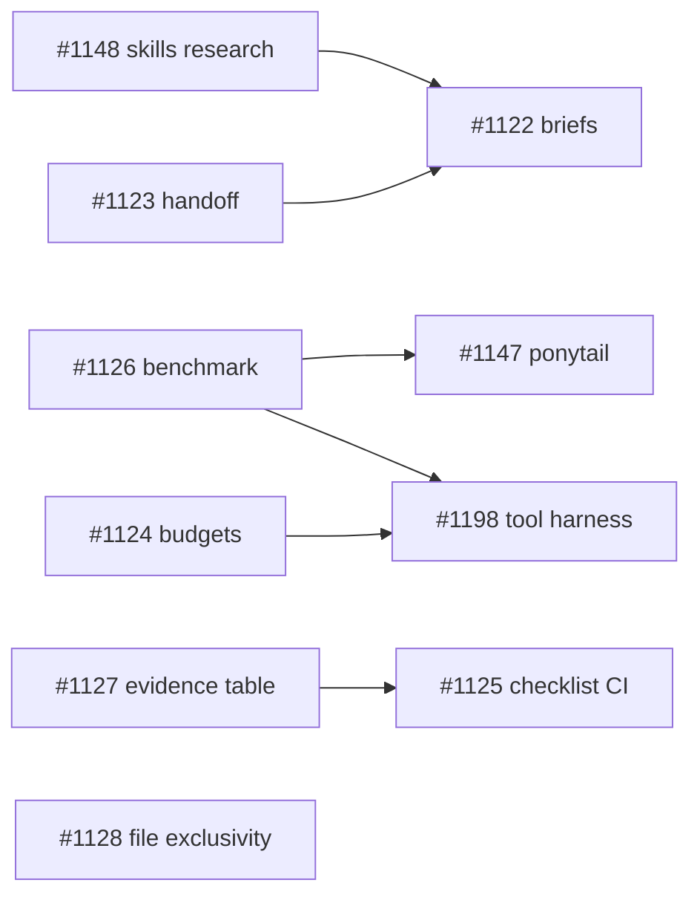

# Refinement drafts: Harness alignment with Composer 2 (Epic #1121)

**Parent Epic:** [#1121](https://github.com/akasper/plate/issues/1121)  
**Sources:** Cursor Composer 2 Technical Report (Andrew, 2026-10-13); Boris Cherny harness habits (Andrew, 2026-10-14); Andrew comments on children  
**Purpose:** Gaps-only refinement for ten open stubs—no second copy of full issue bodies  
**Status:** Docs-only companion; does **not** clear `status:stub` / `need:refinement`

---

## Discovery (2026-11-28)

Searched `gh pr list --state all --search "<n> in:body"` per child, issue comments, and `release-minor` tree (`AGENTS.md`, `docs/agents/`, `src/plate_core/`). No `plate-lifecycle[bot]` refinement comments on this Epic family.

| Issue | State | PRs (body refs) | Source of truth | Already on `release-minor` (evidence) |
|------:|:-----:|-----------------|-----------------|----------------------------------------|
| [#1121](https://github.com/akasper/plate/issues/1121) | OPEN | — | Epic body + [comment](https://github.com/akasper/plate/issues/1121#issuecomment-6167257735) | — |
| [#1122](https://github.com/akasper/plate/issues/1122) | OPEN | — | Issue + [comment](https://github.com/akasper/plate/issues/1122#issuecomment-6167257735) | Partial: on-demand `docs/agents/*.md` + slim core `AGENTS.md` (not briefs/metrics) |
| [#1123](https://github.com/akasper/plate/issues/1123) | OPEN | — | Issue + [comment](https://github.com/akasper/plate/issues/1123#issuecomment-6167257971) | Partial: fleet handoffs `src/plate_core/fleet.py`, `gh plate fleet` (#644)—not session self-summary |
| [#1124](https://github.com/akasper/plate/issues/1124) | OPEN | — | Issue + [comment](https://github.com/akasper/plate/issues/1124#issuecomment-6167258849) | Partial: spend ledger [#1358](https://github.com/akasper/plate/pull/1358) `record_spend_interval`, `gh plate costs`, `src/plate_core/ledger.py`, `src/plate_core/costs.py`—no type budgets or correction-cap policy |
| [#1125](https://github.com/akasper/plate/issues/1125) | OPEN | — | Issue + [comment](https://github.com/akasper/plate/issues/1125#issuecomment-6167260195) | Gap: no checklist-completion CI gate in `.github/workflows/` |
| [#1126](https://github.com/akasper/plate/issues/1126) | OPEN | — | Issue + [comments](https://github.com/akasper/plate/issues/1126#issuecomment-6372534553) | Gap: no locked case set / issue-replay harness under `docs/` or `src/plate_core/` |
| [#1127](https://github.com/akasper/plate/issues/1127) | OPEN | — | Issue body | Partial: PR four-section guide `docs/design/pr-description-conciseness.md` (#1053)—no evidence **table** |
| [#1128](https://github.com/akasper/plate/issues/1128) | OPEN | — | Issue body | Partial: integration overlap guards in `issue_lifecycle_events.py` / babysit wake docs—not exclusive edit lists |
| [#1147](https://github.com/akasper/plate/issues/1147) | OPEN | — | Issue body | Gap: no Ponytail-style pre-coding step in agent briefs |
| [#1148](https://github.com/akasper/plate/issues/1148) | OPEN | — | Issue body | Gap: no `docs/research/mattpocock-skills-vs-plate.md` |
| [#1198](https://github.com/akasper/plate/issues/1198) | OPEN | — | Issue body + [approved criteria comment](https://github.com/akasper/plate/issues/1198#issuecomment-6378040849) | Partial: `src/plate_core/mcp/tool_profiles.py` (#1331); full 202-tool inventory in issue—harness/scorecards not built |

**Related (not children):** [#1086](https://github.com/akasper/plate/issues/1086) STE-lite Epic (pairs with #1122); [#1070](https://github.com/akasper/plate/issues/1070) live proof (consumer of #1126); [#1048](https://github.com/akasper/plate/issues/1048) Pretty PRs (#1127); [#1171](https://github.com/akasper/plate/issues/1171) local review cases (seed for #1126); [#1040](https://github.com/akasper/plate/issues/1040)/[#1047](https://github.com/akasper/plate/issues/1047) token measurement.

**Broken refs in #1123:** `#1099` / `#1100` do not exist in the repo—treat as placeholders until relinked (open question below).

---

## Cross-cutting constraints

- **MCP registration (after [#1544](https://github.com/akasper/plate/pull/1544)):** New tools via `MCP_TOOL_HANDLERS` in `src/plate_core/mcp_server.py`, schemas in `src/plate_core/mcp/tool_definitions.py`, profiles in `src/plate_core/mcp/tool_profiles.py`; extend `tests/test_mcp_registry.py`. Update [#1536](https://github.com/akasper/plate/pull/1536) inventory, [#1538](https://github.com/akasper/plate/pull/1538) `docs/cli-mcp-reference.md`, [#1541](https://github.com/akasper/plate/pull/1541) `tests/fixtures/public_surface_stable.json` for any **stable** surface.
- **Do not edit** always-loaded `AGENTS.md` in refinement PRs for this Epic; child Features may propose on-demand pages under `docs/agents/` or `.agentic/` conventions.
- **No `.plate` schema** changes unless a child explicitly requires runtime config.
- Epic note: two cheap parallel attempts may beat one high-effort run—coordinate with [#1128](https://github.com/akasper/plate/issues/1128) and agent-crews pilot docs (`docs/design/agent-crews-pilot-protocol.md`).

---

## Recommended land order

| Phase | Issues | Rationale |
|-------|--------|-----------|
| 1 | #1148 | Research-only; informs #1122, #1123, Q&A paths without code |
| 2 | #1126 (+ #1040 baseline) | Locked case set unlocks #1147 validation, #1198 arms, STE #1086 claims |
| 3 | #1127 → #1125 | Evidence table schema before CI enforces checklist completion |
| 4 | #1123, #1122 | Handoff + brief shapes depend on #1148 borrowings and slimming policy |
| 5 | #1124 | Extends existing ledger; correction-cap couples to babysit (`docs/agents/pr-feedback-and-babysit.md`) |
| 6 | #1128, #1147, #1198 | Parallelism guard, pre-coding guidance, tool admission harness |

---

## Per-stub gaps (acceptance criteria to add at implementation)

### #1122 — Native-harness briefs and slim AGENTS.md

**Gaps:** Define a **brief template** (intent + test-based done check, median ~390-char target from issue) in `docs/agents/` or `docs/design/`; document what stays in core `AGENTS.md` vs on-demand pages vs hooks/CI (`docs/agents/stub-issues.md`, `.github/workflows/label-check.yml`). **Lessons-learned** channel: process for appending rules via PR when mistakes are corrected (issue comment)—not implemented. **Measure** before/after: reuse #1040/#1126 harness, not ad-hoc runs.

**Dependencies:** #1086 STE-lite scope; #1148 row `writing-for-agents`; avoid contradicting #1053 PR conciseness.

---

### #1123 — Agent self-summary handoff notes

**Gaps:** Standardize handoff block (plan steps done/running/blocked, paths/links, decisions, open issues, next step) for issue comments and/or `.agentic/` progress file—distinct from `fleet.py` multi-agent handoffs. Resume rule: next session reads handoff first (`docs/agents/task-management.md` todo visibility is complementary, not a substitute).

**Dependencies:** Pretty PR / evidence (#1048); fix parent refs #1099/#1100 or file replacement issues.

---

### #1124 — Effort-based run budgets sized by issue type

**Gaps:** Map issue type labels (`Feature`, `Task`, `Research`, …) to default **token / turn / tool-call budgets**; persist on `spend_interval` rows (`src/plate_core/ledger.py`) and surface via `gh plate costs` / `plate_costs`. **Correction cap** (failed check → fix this step only, max 3, then partial status report) belongs in agent guidance and babysit loop docs—not in ledger alone.

**Dependencies:** #1352 ledger (shipped); couples to #1125 evidence when a step fails.

---

### #1125 — Checklist completion rule and CI check

**Gaps:** Workflow job (extend `plate-pr-gates` or sibling) that fails when issue/PR checklists have unchecked items without explicit deferral + reason; build checklist from acceptance checks **before** work starts (issue comment). Must not weaken checks to pass.

**Dependencies:** #1127 evidence column for each checklist row; issue templates under `.github/ISSUE_TEMPLATE/`.

---

### #1126 — PLATE benchmark from real issue replays

**Gaps:** Artifact tree e.g. `docs/plate/research/harness/` or `tests/fixtures/harness/` with **locked CASES** (seeded diffs + real issues like #1115, #1083, #1171 PR set). Runner (CLI or script under `scripts/`, #1017 shell-first) scores correctness, cost, rule compliance, checklist completion; **regression-gate** mode for guidance/prompt PRs. Feeds #1070 validation and #1086 A/B (#1088/#1090).

**Dependencies:** #1040 methodology; #1198 reuses task set—single catalog, two report modes (general vs tool arms).

---

### #1127 — Per-run evidence table for done checks

**Gaps:** Markdown table schema (step, requirement, verdict pass/fail/unresolved, evidence link) embedded in PR body section (extends #1053 sections); agent guidance in `docs/agents/`; optional `gh plate` / MCP helper only if #1544 pattern used. Missing evidence stays visible; model confidence is not evidence.

**Dependencies:** #1048 Epic; pairs with #1125 CI parser.

---

### #1128 — One file, one session: exclusive file lists

**Gaps:** Brief field `exclusive_paths` (glob list) for parallel slices; CI or `gh plate pr preflight` warning when open PRs on same integration branch touch overlapping paths (`src/plate_core/pr_gates_contract.py` patterns). Document epic-level “two cheap parallel attempts” policy.

**Dependencies:** Branch model `docs/agents/branch-model-and-ceremonies.md`; may reference worktree/best-of-n host features without implementing host runtime.

---

### #1147 — Pre-coding necessity check (Ponytail-style)

**Gaps:** Research read of upstream skill (MIT credit); agent brief step documenting why new code is needed (reuse, delete, config). Validate via #1126 with/without arm—not vendor README claims.

**Dependencies:** #1126; #1148 may adopt/adapt wording.

---

### #1148 — Compare mattpocock/skills with PLATE equivalents

**Gaps:** Research doc `docs/research/mattpocock-skills-vs-plate.md` with adopt/adapt/skip per row in issue body; follow-up stubs only where adopt/adapt—do not duplicate #1122/#1123 scope.

**Dependencies:** None (land first).

---

### #1198 — Tool admission criteria and evaluation harness

**Gaps (criteria **approved**; harness **not** built):** Implement proposed children from issue (task set, runner arms A–D, tier env `PLATE_MCP_PROFILE`, audit of 202 tools, scorecards under `docs/plate/research/tool-evals/`). Pass bar remains **draft** until first runs. Consolidate overlapping tool families per issue appendix using `tool_profiles.py`—no new tools without scorecard + checklist.

**Dependencies:** #1126 task set; #1544 handler map; public-surface PRs #1536/#1538/#1541 for any new stable MCP/CLI.

---

## Open questions for Andrew

Recommended defaults are for agents if you do not override.

1. **#1123 parent refs** — `#1099` / `#1100` are missing. Retarget to contemplation/handoff issues (e.g. #1102–#1105 under #1070) or file new stubs?  
   **Default:** Relink to **#1103** (adopter brief) and **delegation packet** design `docs/design/cost-control-narrow-delegation-packets.md` in implementation docs; open tiny Documentation PR to fix issue text when ready (out of scope for this draft PR).

2. **Progress file location** — Issue comment vs `.agentic/` file vs PR description for handoff (#1123)?  
   **Default:** **Issue or PR comment** as canonical; optional mirror under `.agentic/sessions/<run-id>.md` when ledger records a `run_id`.

3. **#1127 vs PR template** — New “Evidence” section or extend “How verified”?  
   **Default:** Named **Evidence table** section after “How verified”; conciseness word target unchanged (#1053).

4. **#1125 enforcement level** — Warn-first vs required check on `release-minor`?  
   **Default:** **Required** on integration branches after 2-week warn-only trial documented in release notes fragment of implementing PR.

5. **#1126 CI gate** — Block guidance-only PRs on regression, or report-only until baseline stable?  
   **Default:** **Report-only** until three baseline snapshots exist; then opt-in required check via workflow input.

6. **#1128 overlap detection** — Compare PR head file lists only, or include unmerged draft PRs?  
   **Default:** **Open + draft** PRs targeting same base; ignore closed.

7. **#1198 core tool count** — Issue suggests ~5–8 core; `tool_profiles.py` `default` expands to five profiles today. Freeze names in inventory (#1536) before cutting tools?  
   **Default:** **Yes**—inventory update PR lists core set before merge cuts; candidate tools stay `on-demand` until scorecard passes.

8. **#1122 lessons section** — Live in `docs/agents/lessons.md` (on-demand) vs `.agentic/lessons.yml`?  
   **Default:** **`docs/agents/lessons.md`** with AGENTS.md one-line pointer in a child Feature (not in this doc-only pass).

---

## References

- Composer / Cherny inputs: child issue bodies and Andrew comments (links in discovery table)  
- Spend ledger: `docs/design/agent-crews.md`, `docs/mcp.md`, `src/plate_core/costs.py`  
- MCP profiles: `src/plate_core/mcp/tool_profiles.py`, issue #1198 appendix  
- Stub process: `docs/agents/stub-issues.md`  
- Parallel refinement pattern: `docs/curiosity/refinement-drafts-1010-knowledge-graph.md` (PR #1557)