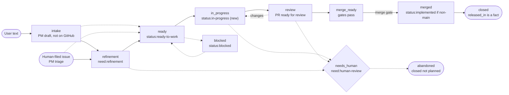

# PLATE issue lifecycle design

One code-owned issue lifecycle built from today's labels and machines. It was revised after two adversarial reviews and adds atomic claims (behind a spike), a compare-and-swap budget pool, versioned marker writes, and no hardcoded logins.

| Field | Value |
|---|---|
| Status | Design approved by Andrew, 2026-11-04 (v3.1). Nothing built yet. |
| Issue | #1420 (parent Epic #1383) |
| Basis | `main` at `f502925` |
| Slice issues | See [Slice issues](#slice-issues) |

> **Basis.** Facts are from the plate repo's main at `f502925` (Nov 4, 2026), a read of the labels and state machine modules, and Epic #1383. v2 and v3 fold in two adversarial reviews by deepseek-v4-pro (via the OpenRouter bot). Each claim was checked against the code and GitHub's API docs before it was adopted. Anything marked (unverified) was not checked. The spec names no login: every login is config.

## What changed in v3

| Change | Kind | Why |
|---|---|---|
| `approvers` defaults to the repo creator: `gh plate init` writes it explicitly, with a runtime fallback to the owner only for user-owned repos (v3.1). No login appears anywhere in the spec. | Changed | PLATE is reusable by anyone, and org repos fail closed |
| A mandatory claim spike, per auth type, before the claim and budget slices | Added | `updateRefs` on `refs/plate/*` is unverified |
| Committed pool held in `refs/plate/budget`, updated by compare-and-swap and cached for 60s | Added | Stops concurrent starts from overshooting the pool, with bounded API cost |
| Every marker write is version-checked and re-read, and non-holders write only under a claim | Changed | v2 wrongly said only the holder writes the marker |
| Marker authenticity (PLATE's login plus a versioned hidden tag) and handling for deleted markers and moved issues | Added | Lookalike or deleted markers could reset state |
| No activity is defined for stale-claim steals | Added | A long silent build looked like a dead holder |
| Non-approver `risk:critical` raises are rate-limited, and pending outside-author issues are capped per author | Added | Low-cost denial-of-service paths |
| Claim costs counted as three writes per start | Fixed | v2 left out the marker commit |
| The daily `drift_scan` pass is opt-in, and the unused claim namespace is dropped after the spike | Cut | Less to run and maintain until drift is observed |
| Build-order note: slices that don't need claims or budget go first | Added | Work isn't blocked on the spike |

## What changed from v1

| Change | Kind | Why |
|---|---|---|
| Per-issue claim is a git ref under `refs/plate/claims/`, written with GraphQL `updateRefs` (create-if-absent, compare-and-swap steal and release) | Added | The v1 claim comment had a real race. GitHub comments have no compare-and-set. |
| Start protocol: claim, tentative reserve, lease, marker commit. Every refusal undoes earlier steps in reverse | Added | v1's 'any refused → stay ready' leaked reservations |
| Watchdog recovery for orphan claims, reservations and leases | Added | Crashes between steps had no repair |
| Untrusted-text rules: quoted data blocks, no instruction authority, per-role tool scopes | Added | Issue text reached agents raw |
| Hard per-issue cap checked in-run; PM flood limits and a daily filing cap | Added | One long stage or a flood could drain the pool |
| Echo matching by `transition_id` instead of actor login | Changed | On plate today PLATE writes with a maintainer's own token, so the login can't tell PLATE from that maintainer |
| `lifecycle.approvers`; gate-label downgrades are approver-only and auto-reverted | Added | Anyone with write access could lower a gate |
| Entry path for human-filed issues; outside authors gated | Added | No path existed; plate is a public repo |
| Configurable taxonomy; gates match attributes, not label names | Added | Adopters with other labels |
| `drift_scan` repairs PLATE's own partial writes | Added | v1 only reconciled human edits |
| Timeouts use GitHub server time, with no cross-machine wall-clock ordering | Added | Clock skew |
| Lull is a required interface with a pluggable adapter. Exclusivity comes from the claim, never from Lull | Changed | v1 said 'required gate' and 'always-grant' together |
| Commemorative: one dedupe key (`event_key`); order by (`writer_id`, `seq`) and marker version | Changed | v1 had two mechanisms and leaned on wall clocks |
| Loop stages are substates inside high-level states, with a mapping table | Changed | v1 left the mapping informal |
| `.plate` budget shown as JSON | Fixed | `.plate` is JSON, not YAML |
| Commemorative forwarder | Cut from first phases | The contract and local log stay, and the forwarder comes later |
| Remote Lull hub adapter | Deferred | Local always-grant, then lockfile, until multi-machine need |
| strict and solo-autonomous presets | Cut | Keeping balanced plus per-key overrides, with the equivalents in a note |
| Refinement-reason labels as states | Cut | They stay labels and are recorded as reasons on the marker |
| Release tracking in the lifecycle | Moved | A `released_in` fact on the marker |
| Cross-repo budget or event aggregation | Non-goal for v1 | One PLATE instance per repo |

## Principles

| Principle | What it means here |
|---|---|
| One home per fact | Rules live in code, gates in `process.yml`, the project budget in `.plate`, current state in one marker comment on the issue, the issue's claim in a git ref, spend in the ledger, events in the local log, and leases in the lease adapter. |
| Marker is state, labels are projections | `lifecycle.py` owns state in the marker, and labels are written from it. A label change PLATE didn't make is never state. It is a request, validated like any other trigger and applied or reverted. |
| One holder per issue | Exclusivity comes from an atomic GitHub ref. Comments, labels and Lull never decide who holds an issue. |
| GitHub's clock | Timeouts compare GitHub server timestamps. A local clock only measures durations inside one process. |
| Transitions are data | One `state_store.Machine` table of (from, event, to) triples, plus a sidecar dict keyed by (from, event) for owner, gate key, timeout, event type and Lull class. No if/else. |
| Idempotent, logged, reversible | Every transition has a `transition_id`, so a second run is a no-op. Each one appends an event before any GitHub write, and a human can reverse it with one comment command. |
| Autonomy by default | Agents move work on their own. Humans gate only what config says, and the PM's or another agent's say-so is never approval. |

## Lifecycle



Dashed edges are side paths. Every open state can also go to abandoned, and needs_human returns to the state it came from. Loop stages are substates inside in_progress, review and merge_ready (see Existing machines), never labels.

## Transitions

**Trigger and owner**

| # | From | To | Trigger | Owner | Done / error / timeout |
|---|---|---|---|---|---|
| 1 | user text | intake | Chat message, `/plate intake` comment, Q&A answer, audit finding | PM (crew role) | Draft complete / ambiguous → ask / 24h → file with defaults / over a flood cap → one Epic proposal |
| 1b | human-filed issue | refinement or ready | Issue opened with no PLATE marker (webhook or scan) | PM triage | Marker added, DoR checked / outside author → refinement until an approver accepts |
| 2 | intake | refinement | PM files issue (`stubs.py` stub→ready→created) | PM + stubs software | Issue exists with marker / GitHub error → retry / n/a |
| 3 | intake | ready | PM files issue that already meets Definition of Ready | PM | Same as 2 |
| 4 | refinement | ready | DoR met: one type, area (Feature), acceptance, tier, risk, allocation, no need:* | Refiner role; planning software for Design/Research/Epic | DoR check passes / 2 failed refines → needs-human / 72h idle → needs-human |
| 5 | ready | blocked | Native blocker opened | Unblock software | Instant |
| 6 | blocked | ready | Last blocker closed | Unblock software | Instant |
| 7 | ready | in_progress | Dispatcher picks issue; start protocol: claim, reserve, lease, marker commit | PM queue + router | Committed / any step refused → undo earlier steps in reverse, stay ready / lease wait 6h → needs-human |
| 8 | in_progress | review | Loop reaches `ready_for_review`: PR ready, CI green, `Closes #N` present | Implementer role (feature/bug loop) | Gates pass / 2 retries then needs-human / wall clock 2h / hard cap → needs-human |
| 9 | review | in_progress | Changes requested or CI red | Babysit software | Fix pushed (claim kept, new two-phase reserve) / 3 fix cycles → needs-human |
| 10 | review | merge_ready | Approvals + all gates pass | Auto-merge eligibility software | Instant |
| 11 | merge_ready | merged | Merge | Human (default) or auto-merge | Merged / conflict → in_progress |
| 12 | merged | closed | Merge to `main` (GitHub `Closes`) | Integration close software | Closed / non-main merge → `status:implemented`, stays open |
| 13 | any active | needs_human | Timeout, retries out, hard cap, budget exhausted, 3 revocations, repeated illegal edit | Watchdog software | Lease released, reservation settled, claim released |
| 14 | needs_human | prior state | Approver comment `/plate resume`, or an approver removes `need:human-review` | Approver (`lifecycle.approvers`) | A work state reruns the start protocol |
| 15 | any open | abandoned | Close as not planned or duplicate | Human; PM for own dupes | Releases everything held |

**Gate, event and lease**

| # | From → To | Human gate (balanced) | Event type | Lull class |
|---|---|---|---|---|
| 1 | text → intake | No | pm_decision | none |
| 1b | human-filed → triage | Outside authors: yes, to reach ready | state_transition | none |
| 2 | intake → refinement | No (always-confirm: yes) | state_transition | none |
| 3 | intake → ready | No (always-confirm: yes) | state_transition | none |
| 4 | refinement → ready | Only risk:critical or Epic | state_transition | `llm-light` |
| 5 | ready → blocked | No | state_transition | none |
| 6 | blocked → ready | No | state_transition | none |
| 7 | ready → in_progress | Only tier:T3 or risk:critical | claim_take, budget_reserve, lease_take, state_transition (or start_aborted) | by tier: T0 `gpu-local`, T1/T2 `agent-seat`, T3 `agent-seat` |
| 8 | in_progress → review | No | pr_opened/updated, ci_gate, lease_release | release implementer lease |
| 9 | review → in_progress | No | state_transition, retry | `agent-seat` |
| 10 | review → merge_ready | No | ci_gate, approval | `review` for reviewer run |
| 11 | merge_ready → merged | Yes | approval, pr_merged | none |
| 12 | merged → closed | No | state_transition, spend_settle | none |
| 13 | → needs_human | n/a | error, spend_settle, claim_release | release all leases |
| 14 | needs_human → | Is the approver step | approval | none |
| 15 | → abandoned | Yes if human-filed | abandon, spend_settle, claim_release | release all leases |

Lull class names (`agent-seat`, `gpu-local`, `llm-light`, `review`) are proposals. `agent-seat` needs Lull's planned non-machine `resource` kind (v0.4). With the default always-grant adapter, the class is recorded but not enforced.

## Start protocol

- **1. Transition id.** `transition_id` = hash(repo, issue, marker version, trigger event id). A duplicate wake computes the same id and becomes a no-op.
- **2. Claim.** Create a commit object (main's tree, with a message that carries `writer_id`, `transition_id`, the target state and the marker comment id), then GraphQL `updateRefs` on `refs/plate/claims/<N>` with `beforeOid` all zeros. That fails if the ref exists, so the loser stops before spending anything.
- **3. Tentative reserve.** A local fast-fail check against the cached pool (at most 60s old), keyed by `transition_id`, expiring after `reservation_ttl` (30m). It never touches the shared pool, so a dead clone's tentative reservation costs nothing.
- **4. Lease.** Acquire through the lease adapter with `idempotency_key` = `transition_id`, so a retried acquire returns the same lease.
- **5a. Pool commit.** Read `refs/plate/budget`, create a commit whose message holds the new committed total and open reservations by issue and `transition_id`, then `updateRefs` with `beforeOid` = the oid just read. If the compare-and-swap fails, re-read, re-check and retry up to 3 times, then undo and stay ready. Committed reservations can never exceed the grant.
- **5b. Marker commit.** Edit the marker to in_progress with the claim oid, reservation, lease id and a `pending_write`, using the expected-version rule (Marker writes). This edit is the commit point for the issue.
- **6. Project.** Add `status:in-progress`, remove `status:ready-to-work`, then clear `pending_write`. A failure here isn't rolled back, because `drift_scan` completes it.

| Refused or failed at | Undo, in reverse order | Then |
|---|---|---|
| 2 claim (ref exists) | Nothing | Stay ready; `start_aborted: claimed` |
| 3 reserve (pressure, allocation, pool) | Release claim: `updateRefs` from our oid to zeros | Stay ready |
| 4 lease (refused, Lull down, no capacity after wait) | Release reservation, release claim | Stay ready; the 6h lease-wait clock keeps running |
| 5a pool compare-and-swap (3 tries) | Release lease, drop tentative, release claim | Stay ready |
| 5b marker write or version check | Pool compare-and-swap to remove the reservation, release lease, release claim | Retry per the GitHub write policy |
| Crash before 5b | Watchdog: a claim whose `transition_id` isn't in the marker is an orphan, released after 15m of orphan time. A pool reservation whose `transition_id` isn't in the marker is removed by compare-and-swap after the same window. Tentative reservations expire on their own, and leases expire at TTL or are released by tags. | Stay ready |
| Crash after 5b | Nothing to undo | Owner resumes, or the watchdog treats it as stale (Recovery and drift) |

> **Verified in docs, not yet in practice.** GitHub's docs say REST `POST /git/refs` returns 422 when the ref exists, and GraphQL `updateRefs` is atomic: `beforeOid` is a precondition, and all zeros means the ref must not exist or, as `afterOid`, deletes it. Claims and the pool ref need Contents write. A start costs three writes on the claim path (commit object, `updateRefs`, marker commit) plus two for the pool (commit object, `updateRefs`). A release costs one claim write and two pool writes. All of these count against GitHub's secondary limits for content-creating requests (about 80 a minute and 500 an hour). Branch rulesets target branches and tags, so `refs/plate/*` should sit outside them, but that is unverified until the spike.

## Claim spike

This is mandatory before any claim or pool code is written. It runs on a private scratch repo (`akasper/plate-claim-spike`, approved and created 2026-11-04). Results are recorded on #1421, and the claim and pool design is chosen from them. First results are in [Claim spike results](#claim-spike-results).

| Check | Record for each: classic PAT, fine-grained PAT, GitHub App installation token |
|---|---|
| Create-if-absent | `updateRefs` with `beforeOid` all zeros on `refs/plate/claims/1` succeeds once, and a second attempt fails |
| Compare-and-swap steal | `beforeOid` = current oid succeeds, and a wrong `beforeOid` fails with no change |
| Compare-and-swap delete | `afterOid` all zeros with the right `beforeOid` deletes, and the wrong one fails |
| Rulesets | Behaviour with a creation-restricting ruleset on all branches, and with typical main-branch protection |
| Burst | 50 claims in quick succession: record any 403 or 429, `Retry-After`, and how GitHub counts GraphQL writes |
| Stability | Whether `updateRefs` is a preview or beta mutation, or needs a preview header |
| Side effects | Claims stay out of the branch list and don't fire `push` or `create` workflows or webhooks |
| Pool ref | The same compare-and-swap checks on `refs/plate/budget` |

If `refs/plate/*` is refused, the claim moves to `refs/heads/plate-claims/*`, with the ruleset exclusion it needs documented. Whichever option isn't chosen is removed from the spec and code.

## Claim spike results

Run on 2026-11-04 (about 9:20 PM ET) with the gh CLI OAuth token (`repo` scope) as repo owner. Not yet tested: a fine-grained PAT, a GitHub App installation token, a non-admin token, webhook side effects, and real secondary-limit thresholds. Those stay open on #1421.

| # | Check | Result | Evidence |
|---|---|---|---|
| 1 | Create-if-absent: `updateRefs` with `beforeOid` all zeros on `refs/plate/claims/1` | Pass | First call succeeds. Second call fails and the ref is unchanged. |
| 1a | Loser's error | Pass, with a caveat | The loser gets HTTP 200 with a generic GraphQL error: "Something went wrong while executing your query…". It is not a typed conflict error. PLATE must re-read the ref to classify a failure. |
| 1b | REST `POST /git/refs` on `refs/plate/claims/3` | Pass | 201 first. 422 "Reference already exists" second, ref unchanged. A clean create-if-absent alternative. |
| 1c | Commit object first | Pass | `updateRefs` to an oid that doesn't exist fails ("twirp error not_found: missing"). A parentless commit also works as a claim target. |
| 2 | Compare-and-swap steal, right `beforeOid` | Pass, with a caveat | Works for a fast-forward (new commit's parent = current oid). A non-fast-forward steal with no `force` is rejected even with the right `beforeOid`. With `force: true` plus the right `beforeOid`, it works. |
| 2a | Steal, wrong `beforeOid` | Pass | Fails with no change, with or without `force: true`. The message is misleading ("rejecting non-fast forward update" or the generic error). |
| 3 | Compare-and-swap delete (`afterOid` zeros) | Pass | Right `beforeOid` deletes. Wrong one fails and the ref stays. Deleting an absent ref fails. |
| 4 | Rulesets | Pass | Three active rulesets, no bypass actors: all branches (`~ALL`: creation, deletion, non_fast_forward), all tags (`~ALL`: creation), default branch (PR required, deletion, non_fast_forward). Under them, `refs/plate/claims/5` create, forced steal and delete all succeed (GraphQL and REST). The controls `refs/heads/plate-claims/5` and `refs/tags/plate-claim-5` are refused ("Cannot create ref due to creations being restricted"). |
| 5 | Burst: 50 concurrent contenders on one N | Pass | Exactly 1 winner, 49 losers, and the final ref equals the winner's commit. 6.1 s. |
| 5a | Burst: 10 N × 5 contenders (50 concurrent) | Pass | Exactly 1 winner for each N. |
| 5b | Burst: 50 distinct N concurrently | Pass | All 50 succeed. |
| 5c | Rate limits | Not hit | About 250 content-creating requests (commit objects plus ref writes) in about 3 minutes, including about 100 in 6 s. No 403, 429 or `Retry-After`. The documented secondary limits weren't reached, so this doesn't show where they bite. |
| 6 | Preview or beta | Pass for github.com | `updateRefs` is in the live schema (`isDeprecated: false`) and works with no preview `Accept` header. GHES 3.0–3.4 docs list it under the "Update refs preview" (`application/vnd.github.update-refs-preview+json`). The current github.com schema-previews page does not list it. GHES adopters need a version check. |
| 7 | Side effects: branch list | Pass | `GET /branches` lists only `main`. `GET /git/matching-refs/plate/` lists the claims. |
| 7a | Side effects: workflows | Pass | A workflow on `push` (all branches and tags), `create` and `delete` ran only once, for the commit that added it. About 130 claim and pool ref writes started no run. |
| 7b | Side effects: webhooks | Not tested | No public receiver. I didn't point a webhook at a third-party URL. The Events API returned 0 events, even for the `main` push, so it's inconclusive. |
| 8 | Pool ref `refs/plate/budget`: create-if-absent and delete | Pass | Same behaviour as claims. |
| 8a | Pool: 20 naive writers from the same base | Pass | Exactly 1 commit wins. |
| 8b | Pool: 12 writers, re-read and retry, grant 8 | Pass, with a caveat | Final committed total = 8 = start (1) + 7 commits, and 5 were refused as full. It never exceeded the grant. Under 12-way contention, some writers needed up to 7 tries, so v3.1's "3 tries then stay ready" refuses starts under heavy contention. That fails safe but wastes work. |

Proposed deltas for slices 3 and 5 (not yet folded into the sections above):

1. Classify every failed `updateRefs` by re-reading the ref. Don't parse error text, because it is generic or misleading.
2. Steals and pool updates use `force: true` together with `beforeOid`. Force doesn't weaken the compare-and-swap, which was verified. Or parent the new commit on the current oid so it fast-forwards.
3. Keep `refs/plate/*`. Drop the `refs/heads/plate-claims/*` fallback from the spec: common creation rulesets block it, and `refs/plate/*` sits outside branch and tag rulesets.
4. Create-if-absent may use REST `POST /git/refs` (clean 422) or `updateRefs`. Either is atomic.
5. Pool retries: 5 tries with jittered backoff, instead of 3. Still fail-safe.
6. Before the claim and budget slices ship to adopters, re-run checks 1–4 and 8 with a fine-grained PAT and with the PLATE GitHub App token.

## Marker writes

- Authenticity: the marker is the one comment whose author is PLATE's own login (`lifecycle.identity`) and whose body starts with the versioned hidden tag `<!-- PLATE-LIFECYCLE:v1 -->`. Any other comment with the tag is ignored and reported once in the digest. The claim commit records the marker comment id.
- Who may write: the claim holder; the watchdog, only after a steal; `drift_scan` and label-event or approver handling, only when no fresh claim is held, and then under a short claim taken with create-if-absent. Otherwise they skip the issue.
- Expected version: every write carries the version it expects to replace. After writing, the writer re-reads. If the marker isn't exactly the previous version + 1 with its own `transition_id`, the write is treated as lost and the writer re-evaluates from what it read.
- Heartbeat: the holder bumps a `heartbeat` field every 30m without changing the state version.
- Deleted marker: if a claim exists, the issue goes to needs_human with its last known state from the claim commit. Pool reservations are rebuilt from `refs/plate/budget`. With no claim, the issue is rebuilt to ready or refinement.
- Transferred or deleted issue: GitHub redirects or 404s, so the watchdog releases the claim, settles the reservation from the ledger and drops the lease. In the new repo it enters as a human-filed issue.

## Labels

| State | Label projection (existing unless marked) | Notes |
|---|---|---|
| intake | none | Lives in `.agentic/stubs/` until filed |
| refinement | `need:refinement`; `need:design`, `need:decision`, `need:reproduction`, `need:tests` stay as labels | Reasons are recorded as `refinement.reasons` on the marker, not as states. Epic stubs also get `status:stub` (planning.py today) |
| ready | `status:ready-to-work` | Set only after DoR passes |
| blocked | `status:blocked` | Driven by native GitHub blockers |
| in_progress | `status:in-progress` (new, the only one) | Linked draft PR and lease show it too |
| review / merge_ready | none on the issue; PR draft vs ready state | PR keeps type, area and `auto-merge` labels |
| merged (non-main) | `status:implemented` | Issue stays open (#556) |
| closed | Issue closed, reason completed | `released_in` is written to the marker from the fragment. It's a fact, not a state |
| needs_human | `need:human-review` plus one PLATE comment saying why | No new label |
| abandoned | Closed as not planned; `duplicate` when it applies | No new label |
| Cross-cutting | Type (one), `area:*`, `tier:T0`–`T3`, `risk:*`, `Epic: <name>` | Inputs to gates and routing, not states |

- **New label:** `status:in-progress` only. Without it, a human or another clone sees `status:ready-to-work` on an issue an agent already holds, which invites double starts. A linked draft PR shows up too late (after plan) and isn't on the board.
- **Zero-label option:** Drop it and project in_progress by removing `status:ready-to-work` and assigning the issue. That works but is less predictable.
- **Config conflict:** `process.yml` lists `status:` in `labels.disallowed_default_prefixes`, yet four `status:*` labels exist and code applies two of them. Fix: keep both `priority:` and `status:` in the disallowed list, and add `labels.lifecycle_labels`, a closed allowlist of `status:*` labels that only PLATE writes. The ban still applies to everything else. Amend `planning_state_rule` to say lifecycle status is code-owned. The review's suggestion to remove `status:` from the list is rejected.
- **Label side effects:** Verified: adding `status:ready-to-work` starts `plates-start-feature.yml` (Feature kickoff), and `plates-agentic-orchestrator.yml` fires on `status:ready-to-work` and `status:blocked`. Every projection write, including a `drift_scan` repair, can trigger them, so both workflows must check the marker and claim and do nothing on an echo (slices 1 and 3).
- **Marker contents:** state, version, `transition_id`, claim oid, reservation, lease, `pending_write`, allocation, settled spend, refinement reasons, `released_in`, and the last 20 transitions. That stays far under GitHub's 65,536-character comment limit.
- **Cleanup found:** Five labels lack descriptions (`need:refinement`, `status:stub`, `status:implemented`, `area:cli`, `Release`), and `Epic:baseline-agents-skills` is missing its space. Fixing those needs approval.

## Existing machines

| Module (today) | Fits the lifecycle as | #1383 child | Order |
|---|---|---|---|
| `integration_close.py`, status labels | The issue lifecycle table and label projection | #1385 | 1 |
| `pm.py` queue (proposed, delegated, blocked, done, cancelled) | Dispatcher for ready → in_progress | #1371 | 2 |
| `feature_loop.py`, `bug_loop.py` stages | Substates inside high-level states (table below) | #1388 | 3 |
| `checkpoint.py` (pending … auto_approved) | The one engine behind every human gate, with revocation | #1374 | 4 |
| `costs.py`, `autonomy.py` pressure, `ledger.py` | Budget guard on transition 7 and settle on 12 | #1379 | 5 |
| `collab.py` claims | Per-issue lock | #1380 (narrowed) | 6 |
| `pr_babysit.py`, `pr_watch_*` | Owner of review | #1372, #1373 | 7 |
| `stubs.py`; `planning.py`, `design_validation.py`, `design_research_approval.py` | Intake and refinement substates | #1395, #1392 | 8 |
| `scheduled_ops.py` | Timers and watchdog for timeouts | #1377 | 9 |
| Auto-merge eligibility | Guard on merge_ready → merged | #1398 | 10 |
| Fragment cut, release ceremony, packaging | Outside the lifecycle; writes `released_in` on the marker | #1376 (before next cut), #1384, #1394 | 11 |
| `fleet.py` handoffs; tier escalation; adoption; marker scanner | Owner handoff in in_progress; retry guard; outside the lifecycle | #1378, #1381, #1396, #1397 | Last |

`state_store.Machine` exists but no module uses it yet. Its real signature is `Machine(name, states, initial, terminal, table)`.

| High-level state | feature_loop stages | bug_loop stages |
|---|---|---|
| in_progress | estimate_cost, plan, open_pr_draft, add_failing_tests, implement, docs_fragment, media_capture | plan, open_pr_draft, add_failing_test, implement_fix |
| review | ready_for_review, babysit | ready_for_review, babysit |
| merge_ready | human_checkpoint, merge_eligible | human_checkpoint, merge_eligible |
| merged | done | done |
| blocked / abandoned | blocked / cancelled | blocked / cancelled |

Stage lists are from the `STAGES` tuples in code. The loop moves substates, but only `lifecycle.py` moves the high-level state, and only when the loop reports the first substate of the next state (for example, entering `ready_for_review` fires in_progress → review). If a loop stage and the marker disagree, that's drift: the marker wins and the loop resyncs.

## Label taxonomy

Verified: `labels.issue_type_labels` and `labels.prefix_convention` (area, risk, need) are already config in `process.yml`. v2 adds `lifecycle.taxonomy` with a tier prefix and a state-to-label map (see Human gates for the YAML). Gate rules match internal attributes such as `risk=critical`, `tier=T3` and `type=Epic`, never label strings, so an adopter can rename `area:` to `category:` without touching code. A label sync creates any missing labels from the map.

## Label events and attribution

> **Login is not identity here.** Verified: on plate today, PLATE agents post to GitHub with a maintainer's own token (`comment_attribution.py` prepends an attribution line for that case), so a label event's actor is the same login whether PLATE or the maintainer made it. `collab.is_bot_login` matches any login ending in bot, so it's no identity check either.

1. Before every label write, PLATE records `pending_write` (`transition_id`, labels added, labels removed) in the marker.
2. An event is an echo if it matches a pending or recent (last 20) PLATE write, or if the resulting label set equals the projection of the current marker. Echoes are ignored, however late they arrive.
3. Duplicate deliveries are dropped by GitHub delivery id or issue-event id. Late events are ordered by GitHub's event id and `created_at`, never local time.
4. Anything else is a human request, `human_label:<label>`, checked against the table from the current state with the same gates and guards.
5. Legal: apply it, keep the label and comment. Illegal: revert from the marker and comment the reason and the allowed next states. A second illegal edit of the same label goes to needs_human instead of reverting again.
6. Gate-label changes also go through the approver rules in the next section.

Settled: PLATE writes through its own identity (a GitHub App preferred), so the login separates writes as well. The echo check stays as defence in depth.

## Who may change gate labels

| Change | Who may | If anyone else does it |
|---|---|---|
| Add or raise `risk:*`, raise `tier:*`, add `need:human-review` or `need:security-review` | Anyone with triage or write access (fail-safe) | Accepted, and the gate applies at the next transition. A non-approver's 4th `risk:critical` raise in a rolling hour is reverted with a comment and noted in the digest. |
| Remove or lower `risk:*`, lower `tier:*`, remove `need:human-review` or `need:security-review` | `lifecycle.approvers` only | Reverted from the marker, with a comment and an event. A repeat goes to needs_human |
| Approval actions: `/plate resume`, `/plate approve`, removing `need:human-review` on needs_human | Approvers, and only when no PLATE `pending_write` matches | Ignored, and the label is re-applied |
| Initial risk and tier when filing | PM, up to `tier:T2` and `risk:high` | n/a |
| `lifecycle.approvers`, gates, taxonomy | A PR to `.agentic/process.yml`, a protected path, merged by a human | n/a |

PLATE's code never removes `need:human-review` or lowers a gate label, and a unit test asserts it. That matters most until PLATE's own identity is live. Area and type edits are routing inputs and are accepted, unless config maps an area to a gate. Approver resolution is in Adopter setup. When no approver can be resolved, every approval-class action is refused, and setup checks report it.

## Human gates

| Gate key | Default (balanced) | Builds on |
|---|---|---|
| merge | Yes | `human_merge_required` |
| risk_critical | Yes | `risk:critical`, autonomy critical actions |
| start_tier_T3 | Yes | `t3_requires_approval` |
| release_cut, deploy_publish | Yes | autonomy critical impact |
| protected_paths | Yes | never-weaken list, now including `.agentic/process.yml` |
| epic_open_close | Yes | what-next catalog |
| abandon_human_filed | Yes | Standing rule |
| non_collaborator_ready | Yes | GitHub `author_association` |
| start (any issue), file_issue, issue_over_allocation | No | none |
| gate_label_downgrade | Approvers, fixed | Who may change gate labels |
| project budget grant or raise | Human, fixed | Project owner's rule |
| license | Human, fixed | Standing rule |

Everything is a per-key override except the fixed rows. `autonomy.risk_tolerance` still caps actions, so the stricter of the two always wins. The presets are cut. Solo-style is `merge`, `epic_open_close` and `abandon_human_filed` set false. Strict-style is `start`, `file_issue` and `issue_over_allocation` set true. These go in the docs as examples, not as shipped presets.


```yaml
# .agentic/process.yml (proposed keys; all optional, defaults shown; one default = balanced)
lifecycle:
  approvers: [<init-user-login>] # written explicitly by 'gh plate init', derived at setup, never a literal in code.
                                # User-owned repo, key absent at runtime: falls back to the repo owner's login.
                                # Org repo, key absent or empty: every approval-class action is refused.
  identity: from_token          # PLATE's own login, read from its token at startup (App [bot] login preferred)
  limits:
    non_approver_critical_per_hour: 3   # risk:critical raises by non-approvers, rolling hour
    pending_outside_issues_per_author: 3
  drift_scan:
    daily_pass: false           # opt-in; touched issues are always scanned
  gates:                        # true = human approval before the transition
    merge: true                 # alias: pull_requests.human_merge_required
    start_tier_T3: true
    risk_critical: true         # any transition into a work state or merge
    release_cut: true
    deploy_publish: true
    protected_paths: true
    epic_open_close: true
    abandon_human_filed: true
    non_collaborator_ready: true  # outside authors stay in refinement until an approver accepts
    gate_label_downgrade: true  # fixed: approvers only
    file_issue: false           # PM files without asking
    start: false
    issue_over_allocation: false
  protected_paths: [AGENTS.md, SPEC.md, .github/workflows/**, LICENSE, .plate, .agentic/process.yml]
  taxonomy:                     # gates match these attributes, never raw label strings
    type_labels: labels.issue_type_labels      # existing key
    prefixes: labels.prefix_convention         # existing: area, risk, need
    tier_prefix: "tier:"
    states:
      refinement: need:refinement
      ready: status:ready-to-work
      in_progress: status:in-progress
      blocked: status:blocked
      merged_non_main: status:implemented
      needs_human: need:human-review
  pm:
    visibility: ask-when-unsure # silent | digest | ask-when-unsure | always-confirm
    digest: daily
    ask_timeout_hours: 24
    max_issues_per_intake: 5
    max_issues_per_day: 20
    max_unstarted_backlog: 50   # above this, intake becomes one Epic proposal
  budget:
    hard_cap_multiplier: 1.5    # of the issue allocation, checked in-run
    spend_check_interval: 5m
    reservation_ttl: 30m        # tentative reservations expire unless committed
    pool_ref: refs/plate/budget # committed pool total, updated only by compare-and-swap
    pool_cache_ttl: 60s
  claim:
    ref_prefix: refs/plate/claims/   # fixed by the spike; the unused option is removed
    orphan_after: 15m           # measured in GitHub server time
    heartbeat_every: 30m
  timeouts:
    in_progress: { wall_clock: 2h, retries: 2, backoff: [5m, 30m] }
  leases:
    adapter: local              # local (always grant) | lockfile; lull hub later
    ttl_s: 600
    grace_s: 60
    no_capacity_deadline: 6h
    revocations_before_human: 3
  events:
    sink: local                 # Commemorative forwarder is a later phase

# .plate is JSON, human-edited only; agents never write the project budget
"autonomy": {
  "project_budget": { "grant_usd": 150, "period": "weekly", "granted_by": "<approver login>", "granted_at": "2026-11-04" }
}
```

## Budget

| Piece | Design |
|---|---|
| Project grant | A human sets `autonomy.project_budget` in `.plate` for a period. Agents can read it but never write it. |
| Issue allocation | At ready, the PM sets one from the pool using an estimate by type and tier (#1124 when it exists) and records it in the issue's state marker. Humans may override it per issue with a `/plate budget N usd` comment. |
| Single enforcement point | `lifecycle.reserve()` runs only on transitions into a work state (7, 9), as a two-phase reserve: tentative until the marker commit, then committed. Every refusal path releases it (Start protocol). Nothing launches without a committed reservation id. |
| Pool across clones | Every clone sees the same numbers because the pool derives from GitHub, never from the local `.agentic/budget/` files. `refs/plate/budget` holds the committed total and open reservations, and markers hold each issue's record. Clones cache the pool for at most 60s. A start costs one pool read plus two writes, with no scan of markers. |
| Overshoot bound | Committed reservations never exceed the grant, because every commit is a compare-and-swap. A stale cache can only refuse a start that would have fit; it can't overshoot. Actual spend can exceed the grant only through in-flight overruns: up to 0.5× allocation plus one check interval of spend per active issue, under the hard cap. |
| Audit | An opt-in pass sums the markers and compares them with `refs/plate/budget`. A mismatch goes to the digest, and the ref is never silently rewritten. |
| Hard per-issue cap | The run's spend is read from the ledger every `spend_check_interval` (5m) and at each stage boundary. At 1× allocation the run finishes its current step and stops. At `hard_cap_multiplier` (1.5×) the supervisor stops the run at once, saves evidence, settles and goes to needs_human. The most it can overrun is one check interval of spend. |
| Settle | At close, abandon or needs_human, spend comes from the ledger by run id, and the unused part goes back to the pool. Settled spend is written to the issue marker. |
| ok | Normal dispatch. |
| elevated | Cap new starts at a set parallelism, prefer lower tiers, and note it in the digest. |
| critical | No new starts. Running work may finish, and T3 is refused. |
| exhausted | Running work stops at the next stage boundary and goes to needs_human with a comment. Work never stops silently. An approver is asked to raise the grant. |
| Over allocation | Between 1× and 1.5× only while project pressure is ok and the issue has an override; otherwise needs_human at 1×. |

> **Two pressure scales today.** Verified: `costs.py` uses elevated at burn ≥50 and critical at ≥80, and `autonomy.py` uses ≥70 and ≥90. The lifecycle needs one scale, which #1379 should settle.

## PM intake

| Topic | Contract |
|---|---|
| Channels | Chat with the PM agent, a `/plate intake` comment by a collaborator, human-filed issues (triage), audit findings and review follow-ups. A channel adapter turns each into one intake record. v1 ships the GitHub-native channels plus today's chat path. Agent-relayed text counts as a request, never approval. |
| Human-filed issues | Triage adds a marker and checks DoR. If GitHub's server-set `author_association` isn't OWNER, MEMBER or COLLABORATOR, the issue stays in refinement until an approver accepts it. Each outside author gets at most 3 pending issues triaged. Beyond that, issues get no PM spend and are listed in the digest, but they aren't closed, because `abandon_human_filed` is gated. |
| Flood limits | At most 5 issues per intake, 20 per day per repo, and 50 unstarted PM-filed issues. Over a cap, the PM writes one Epic proposal or one digest question instead of filing. |
| Dedupe | Before filing: search open and recently closed issues by title and body, plus the stub idempotency marker. On a match, comment on the existing issue instead of filing. |
| When to ask | Only when type, scope or acceptance can't be inferred, or two readings differ in cost by more than 2×. Everything else uses defaults recorded in the issue. |
| Batching | One message per intake with at most 3 questions. Each has a stated default that applies after `ask_timeout_hours`. |
| Visibility | `silent` (no messages), `digest` (one summary a day), `ask-when-unsure` (default: digest plus questions), `always-confirm` (every issue waits for a yes). |
| May do | File issues, apply one type, `area:*`, `tier:T0`–`T2`, `risk:low`/`medium`/`high`, `need:*`, `Epic:` labels, set allocation, and close its own duplicates within 24h. |
| May not do | Approve anything, apply `tier:T3` or `risk:critical` without a gate, lower a gate label, open or close Epics, or exceed the flood limits. Larger work becomes an Epic proposal. |

## Untrusted text

| Rule | Design |
|---|---|
| What is data | Issue, PR and comment bodies and titles, commit messages, CI logs, chat text, and Commemorative summaries. All of it is data, whoever wrote it. |
| Quoted data blocks | Agent packets carry that text only inside a delimited block tagged with its source, author and `author_association`. The packet's instructions say the block has no instruction authority. |
| Where authority comes from | Config on `main`, the marker, the task spec PLATE wrote, and approver actions that pass the login and echo checks. Commands are parsed only from the first line of a comment by an approver, never from quoted or body text. |
| Tool scopes per role | PM: file, label and comment through a bounded schema (title, body, type, area, tier up to T2, risk up to high, need:*), with no code, merge or secrets. Implementer: write to its own branch, with no gate labels and no merge. Reviewer: read plus review comments. |
| Output checks | PM output is validated against the schema. Labels outside the allowlist are dropped, and no new @mentions or outside links are added beyond those in the source. |
| Outside authors | Their text never starts a work state without an approver (Human-filed issues). |
| Scrubbing | The secret scrubber stays, but only for outbound events. It is not an injection defence, so no regex filter is relied on. |

## Commemorative contract

PLATE adopts Commemorative's proposal with these terms. The contract is kept whole, but v1 builds only the local log. The forwarder is a later phase.

| Term | Adopted |
|---|---|
| Format | JSONL, one event per line, `schema_version`, ULID `event_id`, summary ≤500 chars, links instead of bodies |
| Event types | state_transition, pm_decision, approval, lease_take, lease_release, budget_reserve, spend_settle, spend_run, pr_opened, pr_updated, pr_merged, pr_closed, ci_gate, error, retry, abandon |
| Delivery | Append to the local outbox first, then forward async `POST /events` in batches of ≤100 by seq. Acks are per event plus the highest contiguous seq, with a cursor and resend. |
| Never block | 2 s timeout, fire-and-forget, backoff with jitter capped at 5 min. A backlog warning shows in the digest. |
| Scrubbing | A secret scrubber runs before append. No tokens, env values, tool outputs, reasoning, or PII beyond GitHub logins. |
| Not events | Reads, and polling ticks with no change |

- **Answer to its question:** PLATE assigns `seq` at append, per (repo, `writer_id`). Nothing assigns one today.
- **One dedupe key:** `event_key`. For transition events it's `<transition_id>:<type>`. For any other event it's a ULID minted once at append and stored on the line, so a resend carries the same key. The content hash from v1 is dropped.
- **Ordering:** Within a writer, by (`writer_id`, `seq`), and gaps are detected per writer. Within an issue, by the marker version inside `transition_id`, since the claim allows one writer per issue at a time. No global order across writers is claimed. Cross-issue views sort by GitHub server time and are labelled approximate, and `ts` is informational.
- **Outbox merge:** Outboxes are never merged with each other. Each writer forwards its own stream, and Commemorative is the union by `event_key`. Until the forwarder exists, other clones' transitions are visible from the marker's last-20 history.
- **writer_id:** A ULID per clone or cloud agent, kept in `.agentic/events/writer_id`.
- **Concern: log location:** The outbox goes in `.agentic/events/`, git-ignored like the rest of `.agentic/` state, never committed, so there are no merge conflicts.
- **Concern: retention:** Delete raw lines only 90 days after ack and never before an ack. Spend fields aren't in GitHub, so settled spend per issue also goes in the marker comment.
- **Concern: lost clone:** Unforwarded events are lost, apart from state, which is rebuilt from GitHub and markers, and settled spend from the markers. Run-level detail for in-flight work is the only real loss.
- **Adopter setup:** Endpoint and token are optional and set by env. The default `events.sink: local` works with no service.

## Lull contract

> **Design change, stated precisely.** The lease interface is required: every work state acquires, renews and releases through it. The adapter is pluggable. The default is `local` (always grant, which records but enforces nothing), then `lockfile` (one machine, several processes), with the Lull hub adapter later, when there's a multi-machine need. Lull's hub isn't built yet (Lull #10, #11, #19). Lull governs capacity only, and per-issue exclusivity never depends on it.

| Term | Adopted |
|---|---|
| Lifecycle | `POST /v1/leases` acquire, renew every ttl/3 (ttl 30–3600 s, default 600), `DELETE` release with `left_running` and notes, and expiry events |
| Idempotency | `idempotency_key` = repo, issue, transition_id. A retried acquire returns the same lease. |
| Tags | `repo`, `issue`, `state`, `transition_id`, `tier`, plus an opaque `budget` that Lull records but doesn't enforce |
| Class per state | From the transition sidecar. The per-issue lock can be a `resource` lease on `issue:<repo>#N` once that kind exists. |
| Lull down (hub adapter) | Treat it as not free. Use the configured fallback (hosted CI, smaller model) or stay in ready. Never assume a grant. |
| No capacity | Long-poll `wait_seconds` ≤300, then stay ready. After `no_capacity_deadline` (6h), go to needs_human. |
| Revocation without push | Agents poll renew every ttl/3. A 409 or revoked renew means stop within `grace_s`. Max overrun = ttl/3 + `grace_s`, which is 260 s at defaults. If the run hasn't stopped by then, its supervising PLATE process kills it. If the supervisor is dead too, the lease expires at TTL and Lull's reaper (Lull #23) cleans up. |
| Lease lost | Save evidence, release with notes, undo the reservation, and requeue with a new acquire. After 3 revocations or a residue alert, go to needs_human. |
| Crash recovery | On restart, list leases by requester. Resume only if the marker's lease id and claim oid still match; otherwise release. A failed renew is a lost lease (roll back and requeue), not an immediate needs_human. |
| Generic | Nothing PLATE- or project-specific goes in the Lull repo. PLATE only fills in tags. |

## Clocks and ordering

- Timeouts (2h, 72h, 24h, the 15m orphan window, the 30m reservation TTL) compare GitHub server timestamps: the marker's `updated_at`, issue-event `created_at`, and the API response `Date` header for now.
- Local clocks only measure durations inside one process, such as renew intervals, using a monotonic clock.
- Lease TTLs run on one clock: Lull's hub, or the single machine running the lockfile adapter.
- Events are ordered by (`writer_id`, `seq`) within a writer and by marker version within an issue. Wall clocks are never compared across machines.

## Real usage

| Pattern | What the design does |
|---|---|
| Bursty parallel issues | The PM files them all. Dispatch is capped by pressure level and lease capacity, and the rest wait in ready. |
| Overnight runs | Autonomy continues under the preset. Human gates queue, and the morning digest lists what's waiting. |
| Laptop goes offline | Its leases expire at TTL and its log waits. The claim stays until the watchdog sees no activity past the state timeout in GitHub time. Then it steals the claim with a compare-and-swap and retries, or goes to needs_human. |
| Stuck agent | No renew means the lease expires, and the watchdog sees no state change past the timeout. Retry, then needs_human. |
| Duplicate wakes and webhooks | `transition_id` makes a second attempt a no-op. Webhooks are deduped by delivery id, and echoes of PLATE's own writes are ignored. |
| Two agents, one issue | The claim ref decides atomically, and the loser stops before reserving anything. |
| Hostile issue text (public repo) | It's handled as a quoted data block with no authority, and outside authors stay in refinement until an approver accepts. |
| Human edits mid-flight | The edit is reconciled as a request. A new `risk:critical` adds a gate at the next transition, and close by a human always wins. |
| GitHub rate limit or outage | PLATE counts as degraded after 3 consecutive failures, or on a 5xx or a secondary-limit response with Retry-After. It resumes on the first success, and the digest notes degradation past 1h. Nothing new starts while degraded, and label writes queue with backoff. |
| Cost spike | Pressure moves to critical, so no new starts. Per-issue overage goes to needs_human. |

## Timeouts and stuck work

| State or step | Timeout | Retries | Backoff | Then |
|---|---|---|---|---|
| intake (awaiting answer) | 24h | 1 reminder | n/a | File with defaults plus `need:refinement` |
| refinement | 72h idle | 2 refines | n/a | needs_human |
| ready | none | n/a | n/a | Shown in the digest after 7 days |
| in_progress run | 2h wall clock | 2 (one tier step max, #1381) | 5m, 30m | needs_human |
| review fix cycles | per run 2h | 3 cycles | 5m, 30m | needs_human |
| waiting on a human gate | none | n/a | Digest reminder at 48h | Stays put |
| lease wait | 6h | Long-poll repeats | ≤300 s | needs_human |
| orphan claim (no marker commit) | 15m | n/a | n/a | Watchdog releases it |
| tentative reservation | 30m | n/a | n/a | Expires back to the pool |
| revoked lease still running | ttl/3 + grace_s | n/a | n/a | Supervisor kills the run |
| holder heartbeat | 30m | n/a | n/a | Counts as activity |
| GitHub write | 1h | 5 | Exponential, cap 5 min | needs_human only past 1h |
| Event forward | none | Unlimited | Exponential, cap 5 min | Backlog warning, never blocks |

Every value is a config key, measured in GitHub server time. These are starting guesses, to be tuned from timeline data.

## Recovery and drift

| Watchdog check (each wake and every 15m) | Action |
|---|---|
| Claim ref whose `transition_id` isn't in the marker | Orphan: release after 15m of orphan time |
| in_progress with no activity past the state timeout | Activity is any of: a lease renewal the adapter can see, a marker heartbeat, a commit on the linked branch, or a CI run or PR event on the linked PR, all in GitHub time. With none, steal the claim with `updateRefs` (`beforeOid` = the stale oid), settle, then retry or go to needs_human. Only the watchdog steals. |
| Pool reservation whose `transition_id` is in no marker after 15m | Remove it from `refs/plate/budget` by compare-and-swap |
| Issue transferred or deleted, or marker deleted | See Marker writes |
| Lease with no matching marker | Release it |
| Marker in a work state but no claim ref | Re-claim with create-if-absent, or go to needs_human if someone else holds it |

The watchdog and `drift_scan` skip any issue with a fresh claim held by someone else. `drift_scan` runs on every issue touched in a wake. The daily pass over all open issues with a marker (one list call per 100 issues) is opt-in (`drift_scan.daily_pass`) until drift is observed. It compares labels with the marker's projection. An uncleared `pending_write` is PLATE's own partial write, and it's completed quietly with an event and no comment. A difference with no pending write that isn't an echo is a human request (Label events and attribution). A missing or corrupt marker is rebuilt from labels and the timeline, marked `rebuilt`, and noted in the digest. A rebuild only ever lands in ready or refinement, never in a work state.

## Adopter setup

| Item | v1 requirement |
|---|---|
| Identity | Preferred: a GitHub App installed on the repo (a `[bot]` login). Acceptable: a fine-grained token for a dedicated bot account. A maintainer's own token works but weakens attribution, as on plate today until its App is live. |
| Minimal permissions | Issues read/write (labels, comments, marker), Pull requests read/write, Contents read/write (PR branches and claim refs), Metadata read, Actions and Checks read (CI state) |
| Not needed | Administration, Secrets, Workflows write. Editing `.github/workflows` needs a separate grant and approval. |
| Classic token fallback | `repo` (or `public_repo` for public repos), which is broader than needed |
| Labels and config | Label sync from `lifecycle.taxonomy`; gate overrides in `process.yml`; a human sets the project budget in `.plate` |
| Approvers: written at init | `gh plate init` (or adoption setup) always writes `lifecycle.approvers: [login]` into `.agentic/process.yml` explicitly, so the list is visible and editable in a reviewed PR. For a user-owned repo (`owner.type` = User), the login is the user who runs init, which must equal `owner.login`. Otherwise init asks for confirmation. For an org repo (`owner.type` = Organization), init asks for approvers, or takes `--approvers a,b`, and writes nothing until one is given. The login is read from the token at setup (`GET /user`) and is never a literal in code. For Andrew's own projects this resolves to his login. |
| Approvers: runtime fallback | Explicit config always wins. If the key is absent on a user-owned repo, PLATE uses `owner.login` from `GET /repos/OWNER/REPO`, re-read every wake so a transfer follows the new owner, and notes in the digest that the fallback is in use. If the key is absent on an org repo, or present but empty on any repo, every approval-class action is refused until it's set. |
| Approvers: API limits | Verified in GitHub's REST docs: the repository object has `owner` (`login`, `type`) but no creator field. For a user-owned repo the owner is the creator, unless the repo was transferred. An org repo has no single creator in the repo API. The org audit log (`GET /orgs/ORG/audit-log`, phrase `action:repo.create`) does record the actor, but it's documented for GitHub Enterprise Cloud, needs an org owner and `read:audit_log`, and has limited retention, so PLATE doesn't rely on it. Org approvers come from init or config. |
| Optional | The lockfile lease adapter needs nothing. The Commemorative endpoint and token come later, by env. |
| Non-goal | Cross-repo budget, events or dashboards. Run one PLATE instance per repo. |

## Timeline view

`gh plate issue timeline N` reads the local outbox, or Commemorative when it's configured, and prints one line per event: time (ET), from → to, owner, actor, spend so far against the allocation, lease id and class, plus links. A `--json` flag supports agents, and the compact form stays under 2 KB so a lookup costs fewer tokens than reading the issue thread.

## Build plan

| Slice | Scope | Size | Maps to | Kind |
|---|---|---|---|---|
| 1 | `lifecycle.py` table, substate map, taxonomy, projection and `drift_scan` in shadow mode (report only), plus `gh plate issue state N` | M | #1385 | Cost-saving |
| 2 | Local event log (`writer_id`, `seq`, `event_key`) with scrubber and `gh plate issue timeline N` | S | None yet (needs a child) | Cost-saving |
| 0 | Claim spike (Claim spike section), after the scratch repo is approved | S | None yet (needs a child) | Capability |
| 3 | Claim, versioned marker writes, idempotent writes, echo attribution, watchdog | M | #1380, #1395 | Capability |
| 4 | Gate engine: `lifecycle.gates`, approvers, gate-label rules, revocation | M | #1374, #1398 | Capability |
| 5 | Two-phase reserve, `refs/plate/budget` pool, hard cap, `.plate` grant | M | #1379 | Cost-saving |
| 6 | Lease adapter interface: local always-grant and lockfile | S | None (#1377 is adjacent) | Capability |
| 7 | Untrusted-text packets and per-role tool scopes | S | None yet (needs a child) | Capability |
| 8 | PM channels, flood limits, human-filed triage | M | #1371, #1392 | Capability |
| Later | Commemorative forwarder; Lull hub adapter | S each | None | Capability |

> **Build order.** Slices 1, 2, 4 (in shadow), 6, 7 and 8 don't depend on claims or the pool and can go first. Slices 3 and 5 wait for slice 0's recorded results.

- Tests: stdlib unittest for every table row, marker version conflicts, pool compare-and-swap retries, terminal states, projection round-trips, reconciliation cases, duplicate-wake no-ops, claim races against a fake GitHub with compare-and-swap refs, rollback on every refusal path, echo and duplicate webhooks, skewed local clocks, and fallbacks with Lull down.
- Main metric: all-in cost per accepted outcome, defined in `docs/design/agent-crews-pilot-protocol.md` (#1353). It relies on #1352, which is the spend ledger issue ("Spend ledger: record tokens and cloud agent id per run") and not the metric itself.
- Also measure before and after: agent wakes per accepted outcome, label-repair comments, human interventions per issue, and time in each state.
- Slice 1 runs in shadow on plate for a week before any label writes.

## Slice issues

| Slice | Issue | Also touches (existing #1383 children) | Can start before the spike? |
|---|---|---|---|
| Design doc | #1420 | none | n/a |
| 0 Claim spike | #1421 | none | It is the spike |
| 1 Lifecycle table, projection, shadow `drift_scan`, `gh plate issue state N` | #1385 (existing) | none | Yes |
| 2 Local event log | #1422 | none | Yes |
| 2 `gh plate issue timeline N` | #1423 | none | Yes |
| 3 Marker comment, versioned writes, `drift_scan` repair, watchdog | #1424 | #1380 (claim ref as the per-issue lock), #1395 (idempotent writes) | No |
| 4 Approvers, gate keys, gate-label downgrade revert | #1425 | #1374 (approval engine), #1398 (auto-merge) | Yes, in shadow |
| 5 Budget pool ref, two-phase reserve, hard cap | #1426 | #1379 (pressure scale, ledger) | No |
| 6 Lease adapter interface (local, lockfile) | #1427 | #1377 is adjacent, not a duplicate | Yes |
| 7 Untrusted-text packets and tool scopes | #1428 | none | Yes |
| 8 PM intake, flood limits, visibility, human-filed triage | #1429 | #1371 (PM queue), #1392 (planning Q&A) | Yes |
| Later: Commemorative forwarder | #1430 | none | Deferred |
| Later: Lull hub adapter | #1431 | none | Deferred |

## Review claims rejected or changed

| Review claim | Verdict | Why |
|---|---|---|
| Marker write with If-Match on an ETag | Rejected | GitHub comments have no compare-and-set. Replaced by the `updateRefs` claim ref. |
| Regex filter for injection patterns | Rejected | A regex can't catch injection. Replaced by structural data blocks and scoped tools. |
| Remove `status:` from the disallowed prefixes | Rejected | The allowlist is narrower and keeps the ban for everyone else |
| Failed renew on recovery goes straight to needs_human | Rejected | The claim stops a second clone holding the issue, so it's a lost lease: roll back and requeue |
| Watchdog rolls back when the lease expired | Changed | Rollback keys off the marker commit and the claim, since the default adapter never expires |
| Comment on every drift repair | Changed | Own partial writes are fixed quietly with an event. A comment only comes with a reverted human edit. |
| Check spend only at stage end | Changed | One long stage can overrun, so there's an in-run check every 5m and a hard stop at 1.5× |
| Label taxonomy is hardwired | Partly rejected | Type labels and area, risk and need prefixes are already config. Tier, state labels and gate keys weren't. |
| Pluggable condition-action policy engine | Deferred | Gates over attributes plus per-key overrides are enough for now |
| Writers adding `risk:critical` is a denial-of-service | Accepted as fail-safe | Raising a gate stays open to writers, and lowering one is approver-only |
| Check that the actor is a human login | Adopted, sharpened | Login alone fails while PLATE writes with a maintainer's token. It needs approvers, the echo check, and no PLATE code path that removes it. |

Everything else in the first review was adopted as written or with small changes. The reviewer's three cut suggestions were already in v1. Second review (v2 → v3) below.

| Second-review claim | Verdict | Why |
|---|---|---|
| Dead-clone tentative reservations leak the pool | Rejected | Tentative reservations never touch the shared pool. The real issue was overshoot, fixed by the pool compare-and-swap. |
| Persist tentative reservations in `.agentic/budget/tentative/` | Rejected | Other clones can't see local files, and it's unnecessary once the pool is a ref |
| Branch protection blocks claims | Rejected as a blocker | Rulesets target branches and tags. The spike still tests a creation-restricting ruleset. |
| Auto-close stale outside-author issues after 30 days | Rejected | Closing a human-filed issue is gated (`abandon_human_filed`). Instead they're capped per author, get no spend, and are listed in the digest. |
| Keep the daily `drift_scan` (raw report) | Rejected | It's opt-in until drift is observed, as the verified review suggested |
| Tie runner stop APIs to risk tolerance | Deferred | Kept as a residual risk until runners are catalogued |
| Lifecycle allowlist is unenforceable under a shared token | Accepted as residual | It closes when PLATE's own identity is live |

## Residual risks

- Shared identity: until PLATE's own identity (approved) is live, an agent outside PLATE's code with the maintainer's token can forge approval-class actions, and the label-check workflow can't enforce the lifecycle allowlist.
- Marker race: GitHub comment edits have no compare-and-set. Claims serialise writers, and the version check plus re-read catch most lost writes, but two writes landing between the other's write and re-read can still leave one stale write.
- Steal window: a steal between a holder's claim check and its marker write can land one stale write. Steals wait for a long silence with no activity, which makes this rare but not impossible.
- Claims and the pool ref depend on the spike: `updateRefs` on `refs/plate/*` is unverified per token type.
- Spend overrun: committed reservations can't exceed the grant, but in-flight spend can, by up to 0.5× allocation plus one check interval per active issue.
- Kill limits: some runners, including cloud agents, may not stop mid-turn, so the overrun bound depends on each runner's stop API.
- Steering within scope: a steered PM can still file poor issues inside its schema. The flood caps bound the damage.
- A lost clone loses its unforwarded run-level events until the forwarder exists.
- With the daily `drift_scan` off, a missed webhook on an untouched idle issue waits until the issue is next touched. Work states are still covered by the watchdog.
- Bursts can hit GitHub's secondary rate limits, and claims and markers add writes.
- Timeouts, caps and limits are guesses until timeline data exists.
- There's no cross-repo budget, so teams split grants across repos by hand.

## Decisions for Andrew

1. Scratch repo for the claim spike: approved 2026-11-04 and created.
2. Filing the design doc and the new #1383 children: approved 2026-11-04. See [Slice issues](#slice-issues).

- [x] PLATE gets its own GitHub identity, a GitHub App preferred (Settled 2026-11-04)
- [x] Claim-ref design, behind the mandatory spike (Settled 2026-11-04)
- [x] `approvers` defaults to the repo creator: written explicitly at init; runtime fallback to the owner only for user-owned repos; org repos refuse until set (Settled 2026-11-04 (v3.1))
- [x] Balanced is the only default, with per-key overrides (Settled 2026-11-04)
- [x] Hard cap 1.5× with 5m checks; PM caps 5 per intake, 20 per day, 50 unstarted (Settled 2026-11-04)
- [x] Outside-author issues wait for an approver (Settled 2026-11-04)
- [x] Q1–Q4 and Q6–Q8 defaults (new label, marker, allowlist, close at main, 50/80, ask-when-unsure, own dupes) (Settled 2026-11-04)
- [x] Cuts: forwarder later, Lull hub later, presets, reason-label states, release tracking (Settled 2026-11-04)

The settled list is status as of Nov 4, 2026. No design decisions are open. The spike deltas above need review on #1421.

## Revision history

| Version | Date | Author | Change |
|---|---|---|---|
| v1 | 2026-11-04 | PLATE (Grok Bot) | First draft from main `f502925`, the facts file, the gap analysis, and the Commemorative and Lull proposals |
| v2 | 2026-11-04 | PLATE (Grok Bot) | Revised after a deepseek-v4-pro adversarial review via the OpenRouter bot, with each claim checked against main `f502925` and GitHub's API docs. See What changed from v1 and Review claims rejected or changed. |
| v3 | 2026-11-04 | PLATE (Grok Bot) | Second review (Part A verified by the OpenRouter bot) and Andrew's approvals. Covers the claim spike, the pool compare-and-swap, versioned marker writes, marker authenticity and no hardcoded logins. Decisions settled except the scratch repo and filing. See What changed in v3. |
| v3.1 | 2026-11-04 | PLATE (Grok Bot) | Andrew's decision: `approvers` defaults to the repo creator. `gh plate init` writes it explicitly (`--approvers` or a prompt for org repos). If the key is absent at runtime, a user-owned repo falls back to its owner and an org repo refuses. The API limit (no creator field; the org audit log is Enterprise-only) is stated. See Adopter setup. |
| v3.2 (repo) | 2026-11-04 | PLATE (Grok Bot) | Committed to `docs/design/issue-lifecycle.md`. Adds the claim spike results, the slice issue map (#1420–#1431), and marks both filing decisions done. No design change. |
